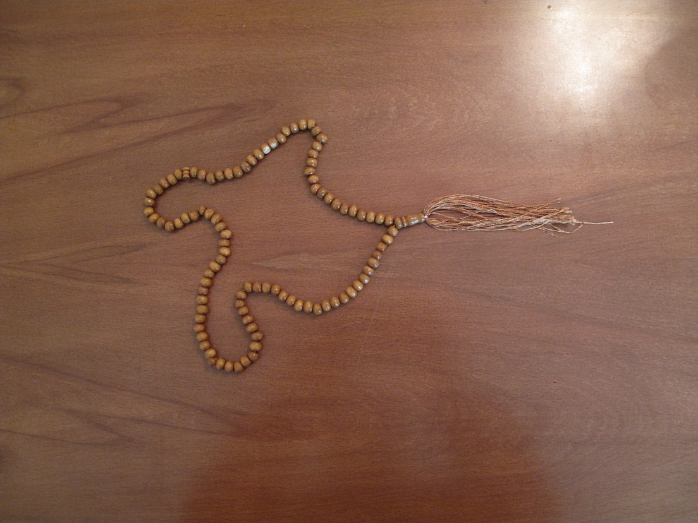
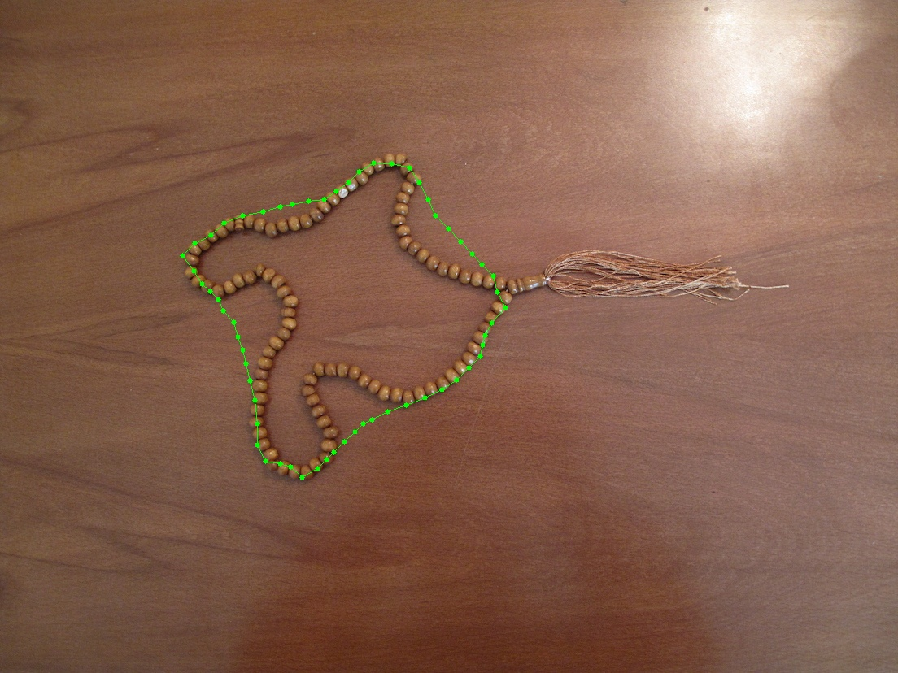

# Active Contour (Snake) Segmentation

This project implements an active contour (snake) algorithm in Python for segmenting objects in images. The snake evolves iteratively to fit the boundaries of an object based on internal and external energy functions.

## Method

The active contour (snake) is a deformable curve represented as points $\mathbf{v}_i = (x_i, y_i), \quad i = 0, \dots, N-1$ that iteratively moves to fit object boundaries in an image. The snake minimizes the total energy:

$$
E_{\text{snake}} = \sum_{i=0}^{N-1} E_{\text{internal}, i} + E_{\text{external}, i}
$$

1. **Initialization:** The snake is initialized as a circle around the object.

   $$
   x_i = x_c + R \sin\frac{2\pi i}{N}, \quad y_i = y_c + R \cos\frac{2\pi i}{N}
   $$

   where $(x_c, y_c)$ is the user-selected center, $R$ is the radius from a second clicked point, and $N$ is the number of points on the snake.
2. **Energy Computation:** The total energy per point is:

   $$
   E_i = E_{\text{internal}, i} + \gamma E_{\text{external}, i}
   $$

   Internal energy keeps the snake smooth and elastic, and external energy attracts it to image edges.

   $$
   E_{\text{internal}, i} = \alpha (\|\mathbf{v}_{i+1} - \mathbf{v}_i\|^2 - d)^2 + \beta \|\mathbf{v}_{i+1} - 2\mathbf{v}_i + \mathbf{v}_{i-1}\|^2, \quad
   E_{\text{external}, i} = - \gamma \, |\nabla I(\mathbf{v}_i)|
   $$

   $d$ is the target inter-point spacing (mean contour length per point) controlling elasticity and $\nabla I(\mathbf{v}_i)$ is the image gradient magnitude at snake point $\mathbf{v}_i$.
3. **Snake Update:** Snake points iteratively move along their normals to minimize energy, using either greedy (independent point updates) or dynamic programming (jointly optimizing consecutive points for global energy) approaches:

   $$
   \mathbf{v}_i \gets \mathbf{v}_i + \Delta s_i \mathbf{n}_i, \quad 
   \Delta s_i = \arg\min_{s \in [-r, r]} E_i(\mathbf{v}_i + s \mathbf{n}_i)
   $$

   where $\mathbf{n}_i$ is the normal direction at snake point $\mathbf{v}_i$.
4. **Convergence:** The algorithm repeats point updates until the snake’s movement between iterations is smaller than a set threshold or the maximum number of iterations is reached.

## Result

<video width="1104" height="828" controls>
  <source src="contour.mp4" type="video/mp4">
</video>

<table>
 <tr>
    <td align="center">Original Image</td>
    <td align="center">Final Result</td>
  </tr>
  <tr>
    <td></td>
    <td></td>
  </tr>
</table>
