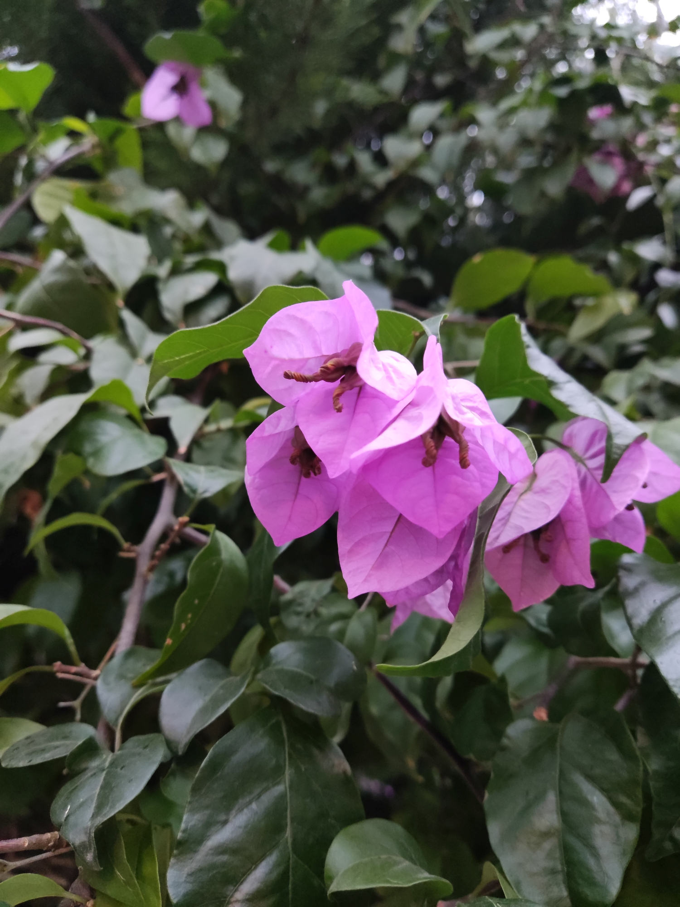
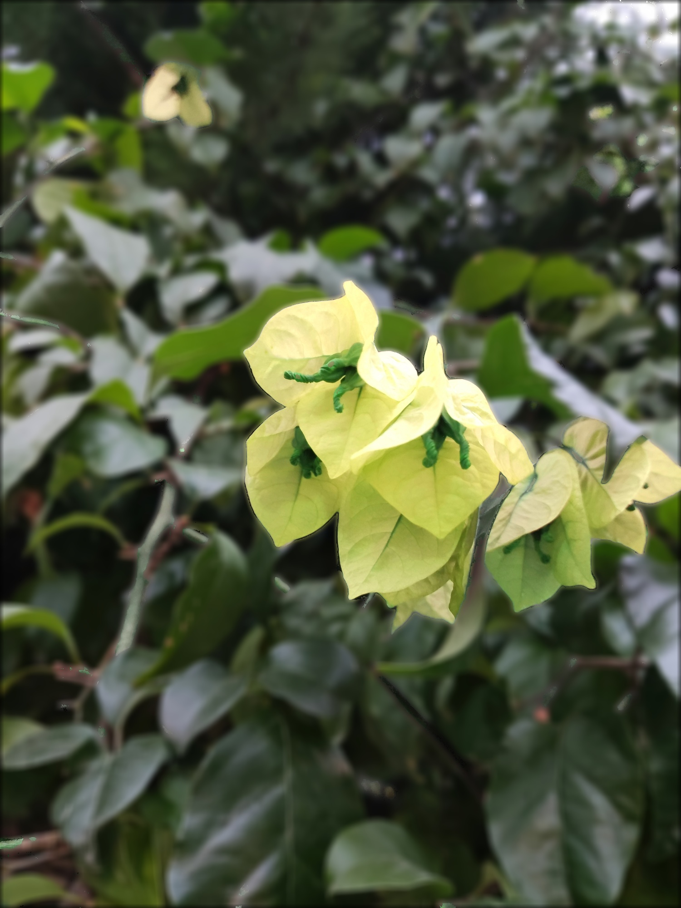

# Color Processing and Blurring

This project processes an image by detecting pink flowers, converting their color to yellow, and applying a smooth blur filter to all non-pink background regions.

## Method

1. **Detect pink flowers:** Convert the image to HSV color space and create a mask for pixels with hue values corresponding to pink.
2. **Change flower color:** Shift the hue of masked pink regions to turn the flowers yellow, then convert the image back to BGR.
3. **Blur the background:** Apply a mean blur to the entire image and restore the original sharp pixels in the flower regions using the mask.

## Results

<table>
 <tr>
    <td align="center">Original Image</td>
    <td align="center">Final Result</td>
  </tr>
  <tr>
    <td></td>
    <td></td>
  </tr>
</table>
