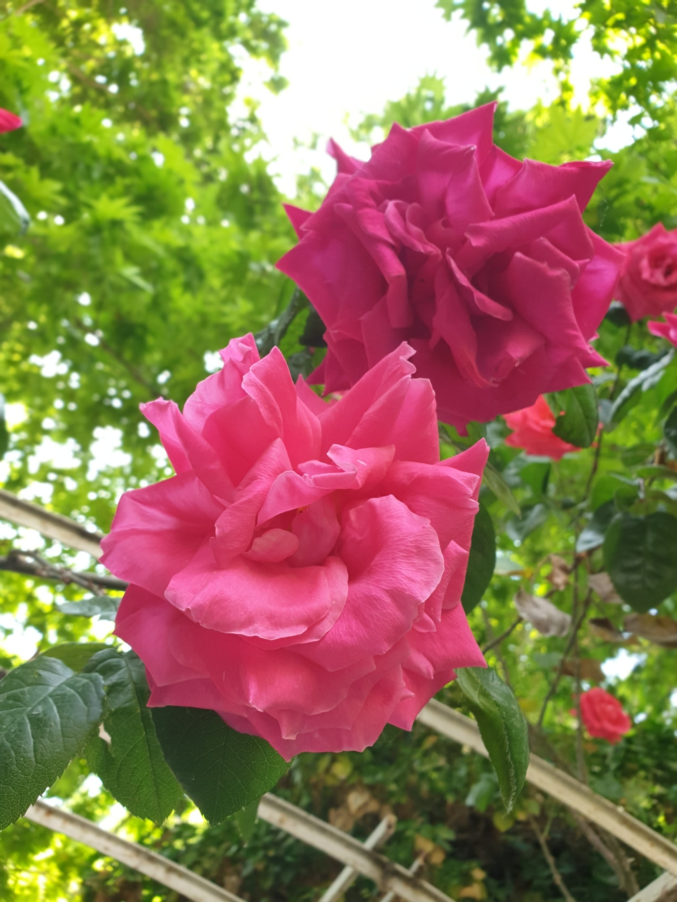

# Image Smoothing Comparison

This project compares three methods of applying a 3×3 box filter to an image:

1. OpenCV (filter2D)
2. Manual nested loops
3. NumPy vectorized slicing

## Results

<table>
 <tr>
    <td align="center">Original Image</td>
    <td align="center">Final Result of 3 Methods</td>
  </tr>
  <tr>
    <td></td>
    <td></td>
  </tr>
</table>
