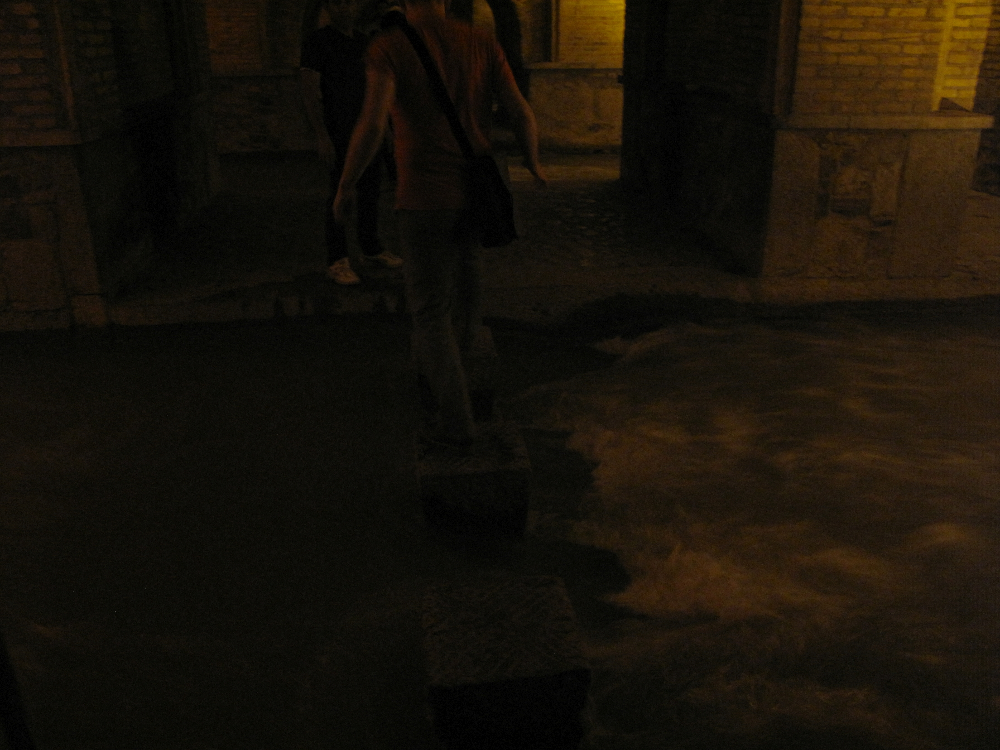
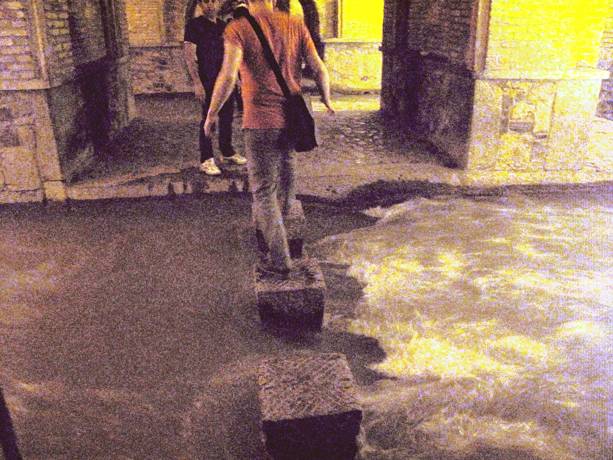
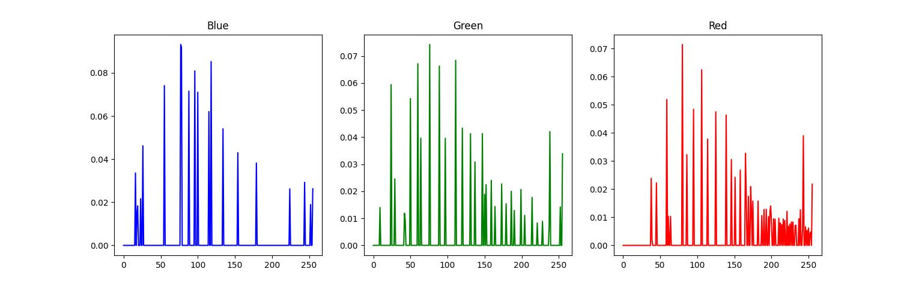

# Histogram Matching (Histogram Specification)

This project implements Histogram Matching—also known as Histogram Specification—based on the method described in Gonzalez & Woods, Digital Image Processing. The goal is to transform an input image so that its histogram becomes as close as possible to a specified target histogram (or a target image’s histogram).

## Method

1. **Equalize the input image:** Compute the histogram and cumulative distribution function (CDF) of the input image. Use the CDF to map input intensities r to equalized intensities s: $s = T(r)$
2. **Compute the CDF of the specified histogram:** Using the desired histogram $p_z(z)$, compute $G(z)$, the equalization transform of the target histogram.
3. **Build the inverse mapping:** Instead of computing $G^{-1}$ analytically, compute all values of $G(z)$ and, for each value of $s$, find the closest $G(z)$. This gives the mapping: $z = G^{-1}(s)$
4. **Apply the mapping to all pixels:** Replace every pixel with its matched intensity to form the final image whose histogram approximates the specified histogram.

## Results

<table>
 <tr>
    <td align="center">Source Image</td>
    <td align="center">Target Image</td>
    <td align="center">Final Result</td>
    <td align="center">Final Histogram</td>
  </tr>
  <tr>
    <td></td>
    <td></td>
    <td></td>
    <td></td>
  </tr>
</table>
