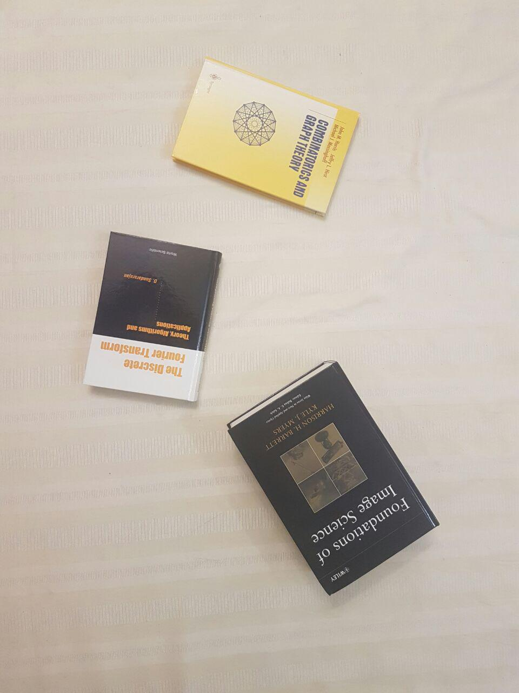
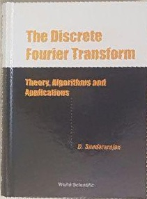
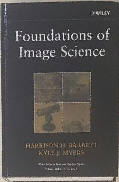

# Perspective Warping

This project implements a manual perspective warping algorithm to extract and rectify book covers from a single image taken at an angle. The goal is to transform each book into a flat, rectangular, top-down view using projective geometry, without using on OpenCV.

## Method

1. Four corner points are manually selected for each book in the image.
2. A homography matrix is computed using these source points and a rectangular destination.
3. The image is warped manually by projecting each pixel using homogeneous coordinates.
4. Any unfilled pixels in the output image are filled by averaging neighboring pixels.

## Result

<table>
 <tr>
    <td align="center">Original Image</td>
    <td align="center">Book 1</td>
    <td align="center">Book 2</td>
    <td align="center">Book 3</td>
  </tr>
  <tr>
    <td></td>
    <td></td>
    <td></td>
    <td></td>
  </tr>
</table>
