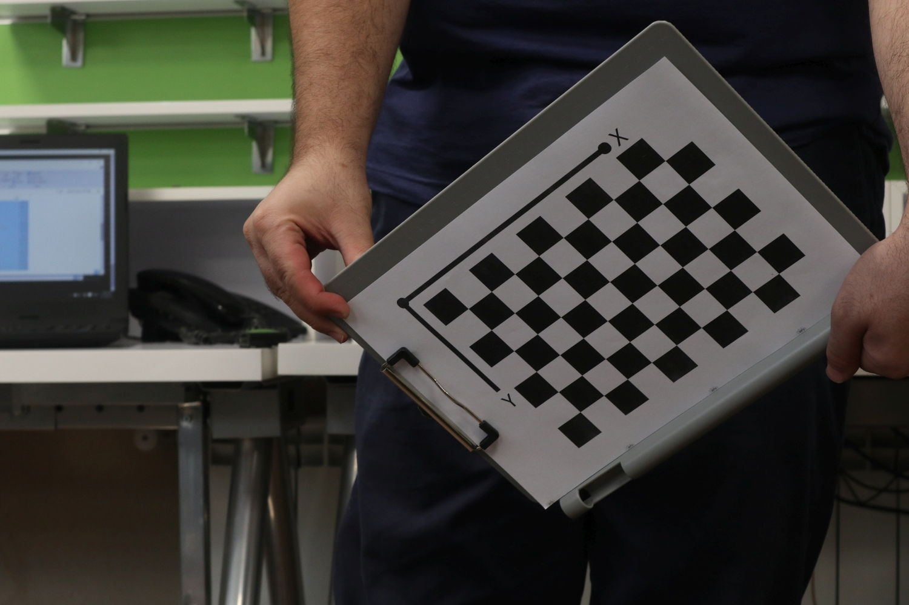
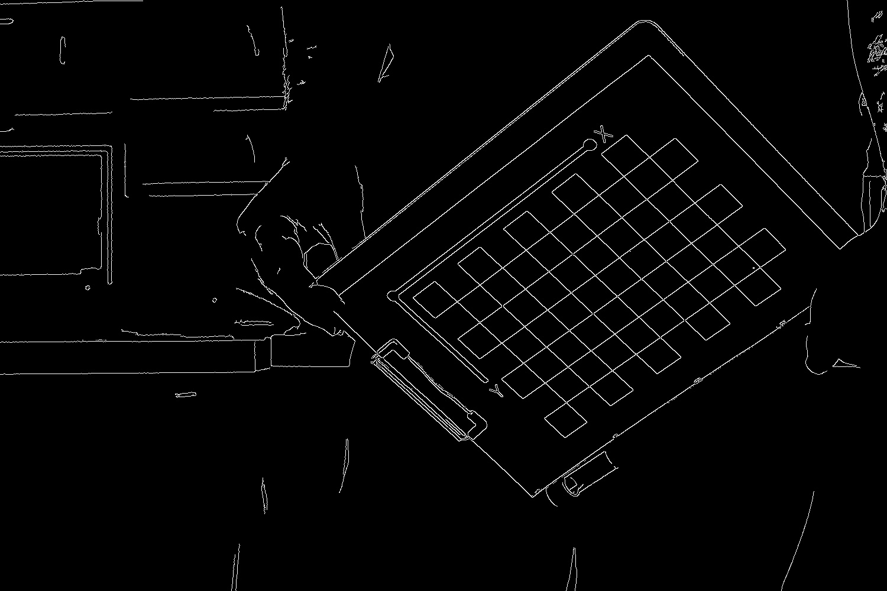
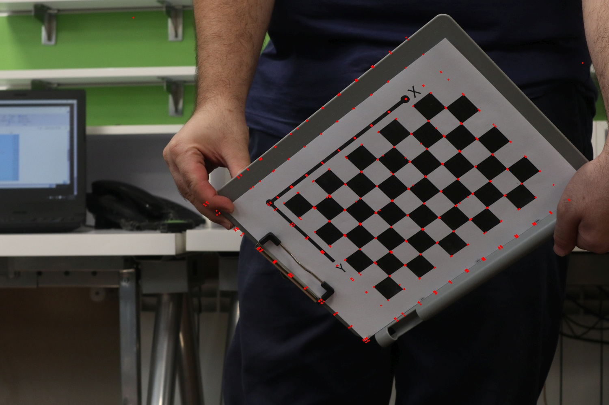
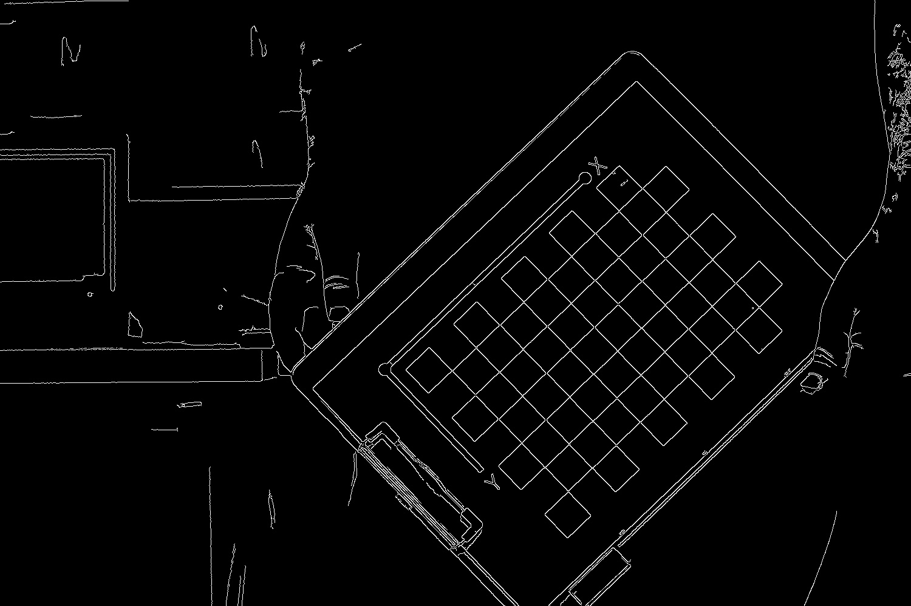
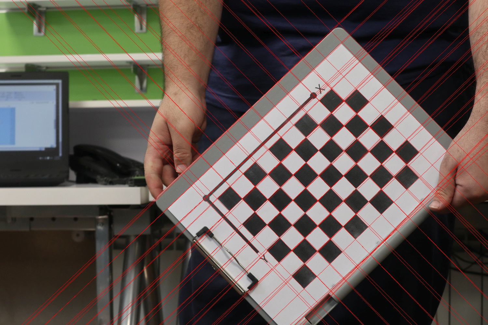
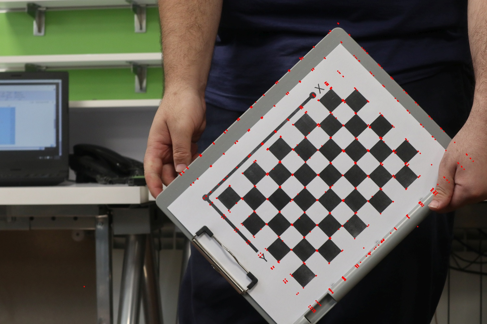

# Chessboard Detection using Hough Transform

This project implements a custom Hough Transform pipeline to detect lines and corners of a chessboard in images.

## Method

1. **Edge Detection:** Convert the input image to grayscale and detect edges using the Canny edge detector.
2. **Hough Transform:** Compute a Hough accumulator over the edge image to detect lines in polar coordinates.
3. **Line Filtering:** Merge similar lines and filter lines corresponding to the chessboard based on intensity differences across the line.
4. **Corner Detection:** Compute intersections of chessboard lines to detect corner points of the chessboard.

## Result

<table>
 <tr>
    <td align="center">Image 1</td>
    <td align="center">Edges</td>
    <td align="center">Lines</td>
    <td align="center">Corners</td>
  </tr>
  <tr>
    <td></td>
    <td></td>
    <td></td>
    <td></td>
  </tr>
</table>

<table>
 <tr>
    <td align="center">Image 2</td>
    <td align="center">Edges</td>
    <td align="center">Lines</td>
    <td align="center">Corners</td>
  </tr>
  <tr>
    <td></td>
    <td></td>
    <td></td>
    <td></td>
  </tr>
</table>
