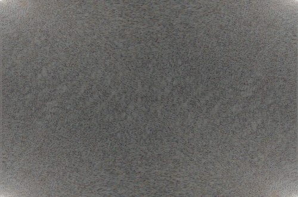
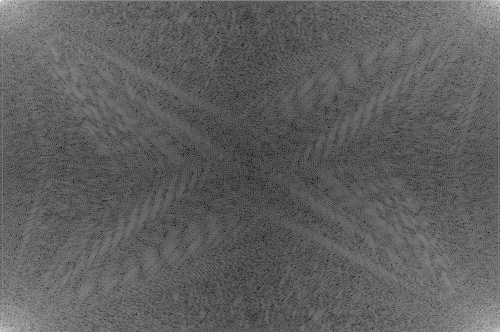
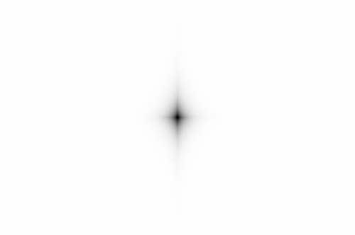
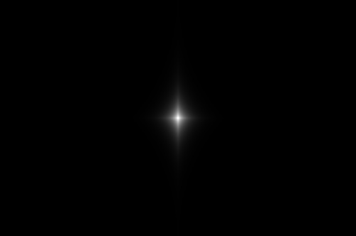
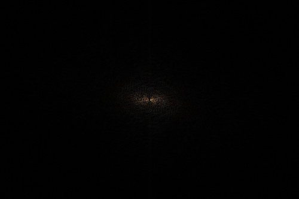
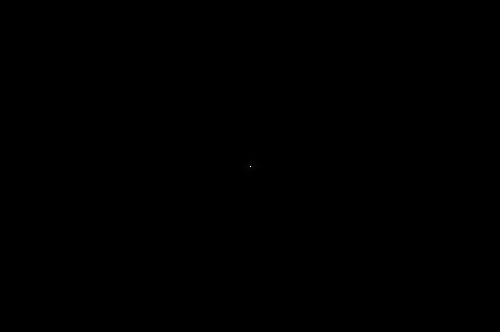
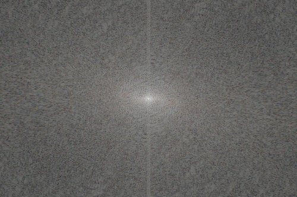
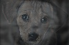
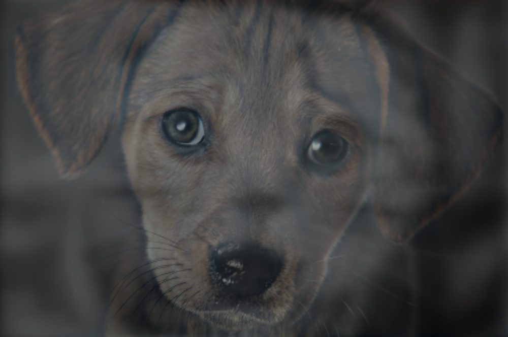

# Hybrid Images Using Frequency-Domain Filtering

This project implements the construction of hybrid images using Discrete Fourier Transform (DFT)–based frequency-domain filtering. A hybrid image appears as one image when viewed from close distance (high frequencies) and as another image when viewed from far distance (low frequencies).

## Method

1. **Image Alignment:** Resize and geometrically align the near and far images so that corresponding features (e.g., eyes or object centers) overlap in the spatial domain.
2. **Frequency Transformation:** Convert both images to the frequency domain using the 2D Discrete Fourier Transform (DFT).
   $$
   F(u,v) = \sum_{x=0}^{M-1} \sum_{y=0}^{N-1} f(x,y), e^{-j2\pi\left(\frac{ux}{M} + \frac{vy}{N}\right)}
   $$
3. **Frequency Filtering:** Apply Gaussian filters in the frequency domain:
   1. Low-pass filter (far image):

      $$
      H_{LP}(u,v) = e^{-\frac{D(u,v)^2}{2\sigma_s^2}}
      $$
   2. High-pass filter (near image):

      $$
      H_{HP}(u,v) = 1 - H_{LP}(u,v)
      $$

      where is the distance from the frequency center.
3. **Combination and Reconstruction:** Combine the filtered spectra using weighted averaging:

$$
F_{hybrid}(u,v) = \alpha F_{near}^{HP}(u,v) + (1-\alpha) F_{far}^{LP}(u,v)
$$

    Finally, apply the inverse DFT to reconstruct the hybrid image in the spatial domain

## Result

### Original Images

<table>
 <tr>
    <td align="center">Near Image</td>
    <td align="center">Far Image</td>
  </tr>
  <tr>
    <td></td>
    <td></td>
  </tr>
</table>

### Frequency-Domain Representation

<table>
 <tr>
    <td align="center">DFT (Near Image)</td>
    <td align="center">DFT (Far Image)</td>
  </tr>
  <tr>
    <td></td>
    <td></td>
  </tr>
</table>

### Gaussian Filters

<table>
 <tr>
    <td align="center">High-Pass Filter</td>
    <td align="center">Low-Pass Filter</td>
  </tr>
  <tr>
    <td></td>
    <td></td>
  </tr>
</table>

### Filtered Spectra

<table>
 <tr>
    <td align="center">High-Passed Near Image</td>
    <td align="center">Low-Passed Far Image</td>
  </tr>
  <tr>
    <td></td>
    <td></td>
  </tr>
</table>

### Hybrid Image Frequency Domain

<table>
 <tr>
    <td align="center">Combined frequency-domain representation</td>
  </tr>
  <tr>
    <td></td>
  </tr>
</table>

### Hybrid Images

<table>
 <tr>
    <td align="center">Downscaled hybrid image (Far view)</td>
  </tr>
  <tr>
    <td></td>
  </tr>
</table>

<table>
 <tr>
    <td align="center">Hybrid image (Near view)</td>
  </tr>
  <tr>
    <td></td>
  </tr>
</table>
