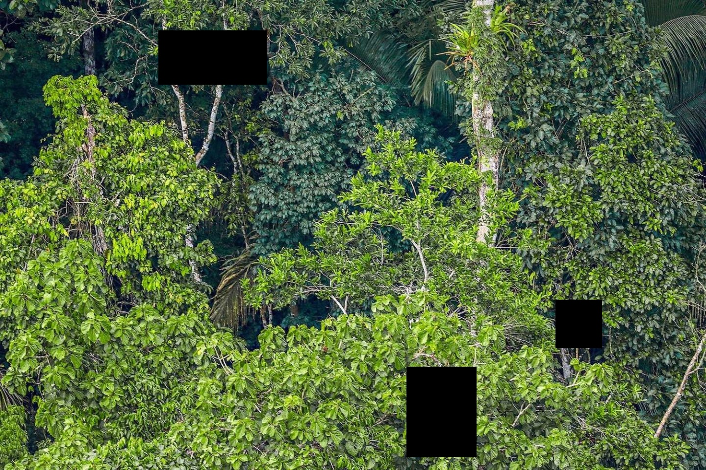

# Patch-Based Image Inpainting with Minimum-Cut Seam Blending

This project implements a patch-based image inpainting algorithm that fills missing or damaged regions of an image by copying patches from surrounding texture regions. To ensure seamless blending, the algorithm uses boundary-aware patch selection and minimum-cut seams to minimize visible artifacts along patch boundaries. The approach is inspired by classic texture synthesis and image quilting techniques.

## Method

1. **Target region removal:** The selected target region is cleared (set to zero) and will be reconstructed using nearby textures.
2. **Patch sampling:** Patches are randomly sampled from regions surrounding the target area, optionally constrained by a texture margin.
3. **Boundary comparison:** For each candidate patch, the overlapping boundaries (left, top, right, bottom) are compared against already-filled pixels using a normalized RMS error.
4. **Best patch selection:** The best-matching patch (or one of the top k candidates) is selected based on minimum boundary distance.
5. **Seam blending:** Minimum-cut seams (vertical and/or horizontal) are computed over the overlapping regions to determine which pixels to copy, reducing visible seams.

### Result

<table>
 <tr>
    <td align="center">Original Image</td>
    <td align="center">Inpaint Area</td>
    <td align="center">Final Result</td>
  </tr>
  <tr>
    <td></td>
    <td></td>
    <td></td>
  </tr>
  <tr>
    <td></td>
    <td></td>
    <td></td>
  </tr>
</table>
