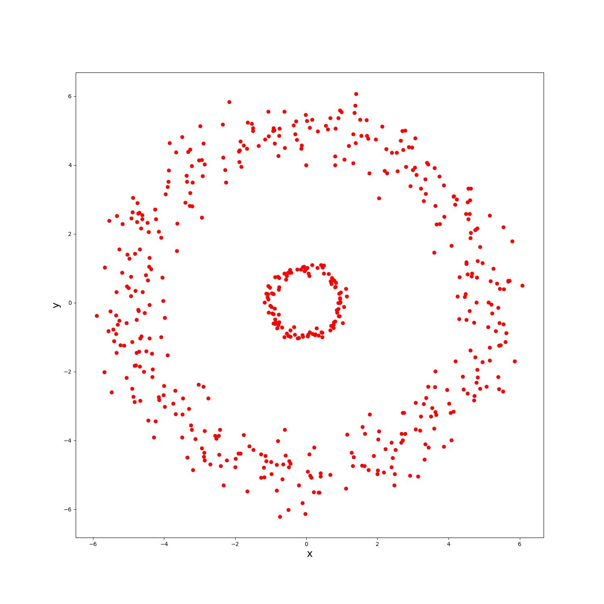
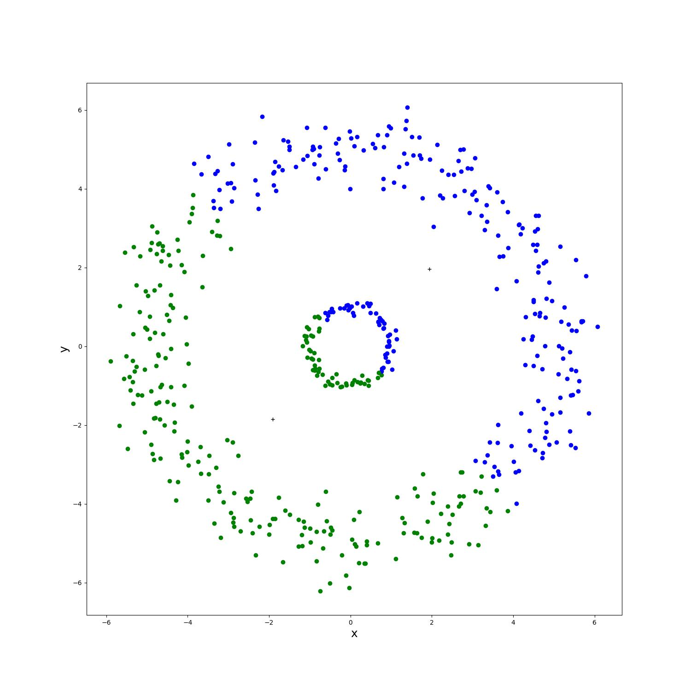
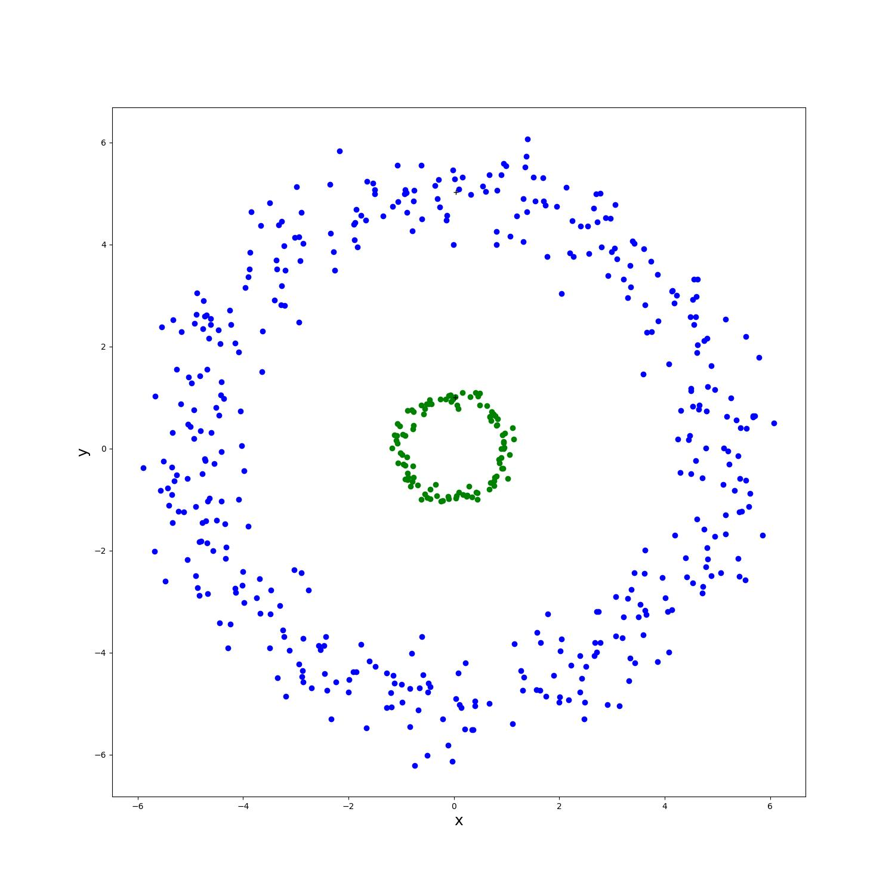

# K-Means Clustering in Cartesian and Polar Coordinates

This project implements the k-means clustering algorithm from scratch using NumPy and Matplotlib. The program clusters 2D points in Cartesian coordinates and compares the results with clustering performed in polar coordinates.

## Results

<table>
 <tr>
    <td align="center">Original Points</td>
    <td align="center">K-Means (Cartesian)</td>
    <td align="center">K-Means (Polar)</td>
  </tr>
  <tr>
    <td></td>
    <td></td>
    <td></td>
  </tr>
</table>
