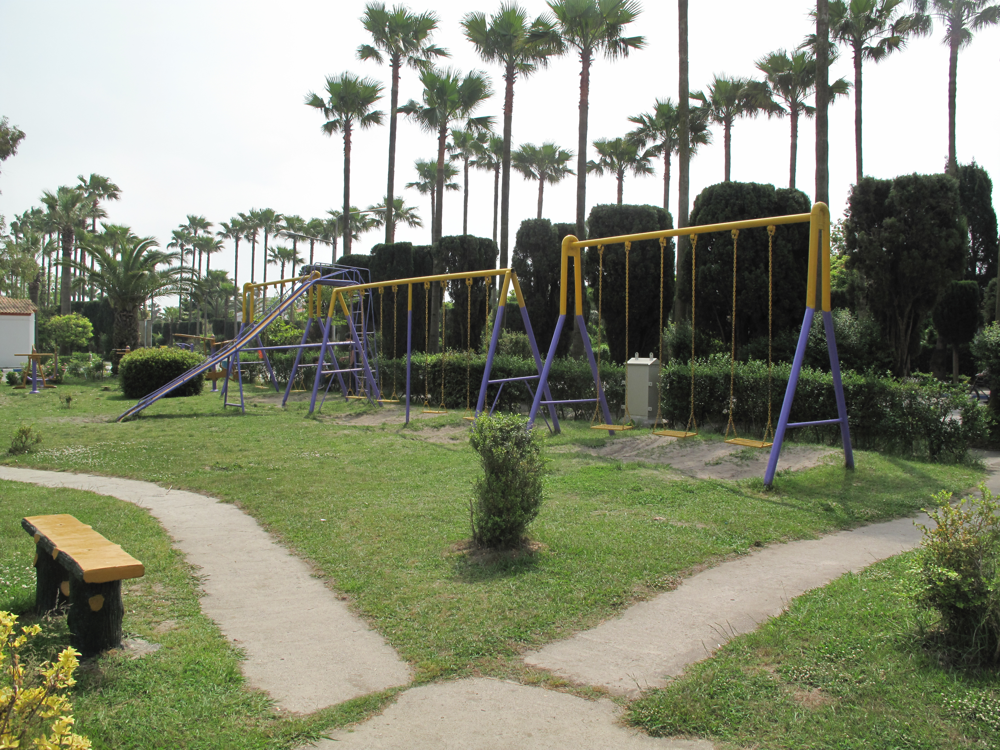
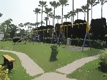

# Mean Shift Image Segmentation

This project implements a simple Mean Shift algorithm for image segmentation. Mean Shift is a clustering algorithm that groups pixels based on color similarity and spatial proximity, producing smooth, segmented regions in an image.

## Method

1. **Feature Space:** Each pixel is represented as [x, y, L, A, B], combining its position and color in LAB space.
2. **Mean Shift Iteration**:
   1. For each pixel, find neighbors close in space and similar in color.
   2. Move the pixel toward the average of neighbors.
   3. Update both position and color.
3. **Repeat:** Perform the mean shift update for max_iter iterations until pixels converge.

## Result

<table>
  <tr>
    <td align="center">Original Image</td>
    <td align="center">Final Result</td>
  </tr>
  <tr>
    <td></td>
    <td></td>
  </tr>
</table>
