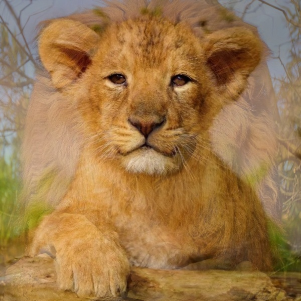
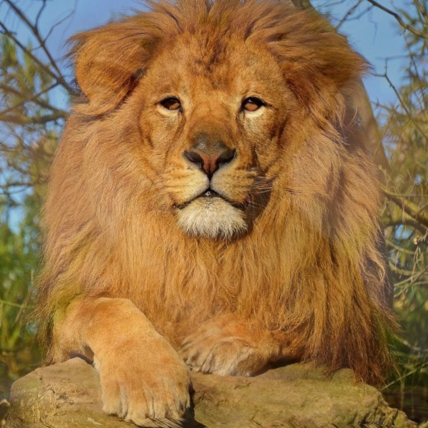

# Image Morphing with Delaunay Triangulation

This project implements a simple image morphing pipeline that smoothly transitions one image into another using Delaunay triangulation and affine warping of triangular regions.

## Method

1. **Select Corresponding Points:** Manually pick matching landmarks on both images using mouse clicks.
2. **Delaunay Triangulation:** The selected points on the first image are triangulated using Delaunay triangulation. This creates triangles that cover the image with well-shaped, non-overlapping triangles for warping.
3. **Affine Warping of Triangles:** Each triangle from the source images is warped to match the corresponding triangle in the interpolated image. The affine transformation ensures that straight lines remain straight and preserves triangle geometry.
4. **Morphing via Linear Interpolation:** Intermediate points are computed using a linear blend between corresponding points of the two images. The warped images are then blended proportionally using the same weight to generate the morphed frame.

## Result

<table>
  <tr>
    <td align="center">Source Image 1</td>
    <td align="center">Source Image 2</td>
    <td align="center">Morphed Frame 15</td>
    <td align="center">Morphed Frame 30</td>
  </tr>
  <tr>
    <td></td>
    <td></td>
    <td></td>
    <td></td>
  </tr>
</table>

