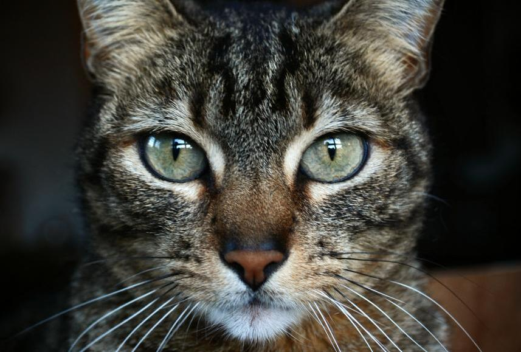
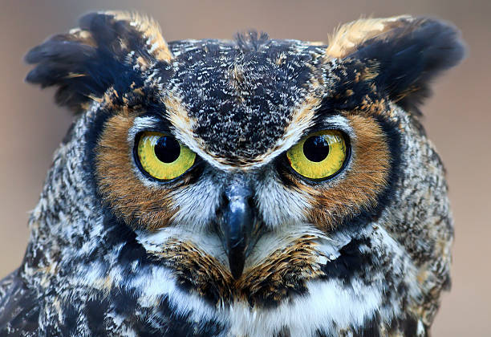
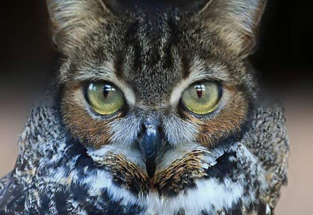
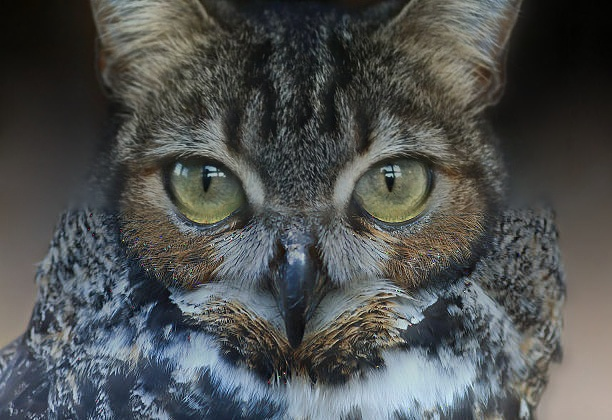

# Multiresolution Blending and Feathering

This project implements multiscale image blending using Gaussian/Laplacian stacks and Laplacian pyramids. Supports both stack-based blending (constant resolution) and pyramid-based blending (downsampled multi-resolution), with soft, feathered masks for smooth transitions.

## Methods

1. **Stack-Based Blending:** This method builds Gaussian and Laplacian stacks at the original image resolution (no downsampling). Each level of the Laplacian stack represents differences between increasingly blurred versions of the image. Blending is done by combining corresponding levels of the two images with a soft, scale-space mask, and then summing all levels to produce the final image.
2. **Pyramid-Based Blending:** This method constructs true multi-resolution Laplacian pyramids, where each level is downsampled by a factor of 2. Laplacian bands capture image details at different scales, and blending is performed level by level using feathered masks, then reconstructed from coarse to fine. This approach handles large images, misalignments, and differences in scale better than stack blending, producing smooth, seamless transitions across the blend.

## Result

<table>
 <tr>
    <td align="center">Image 1</td>
    <td align="center">Image 2</td>
    <td align="center">Stack Blend Result</td>
    <td align="center">Pyramid Blend Result</td>
  </tr>
  <tr>
    <td></td>
    <td></td>
    <td></td>
    <td></td>
  </tr>
</table>
