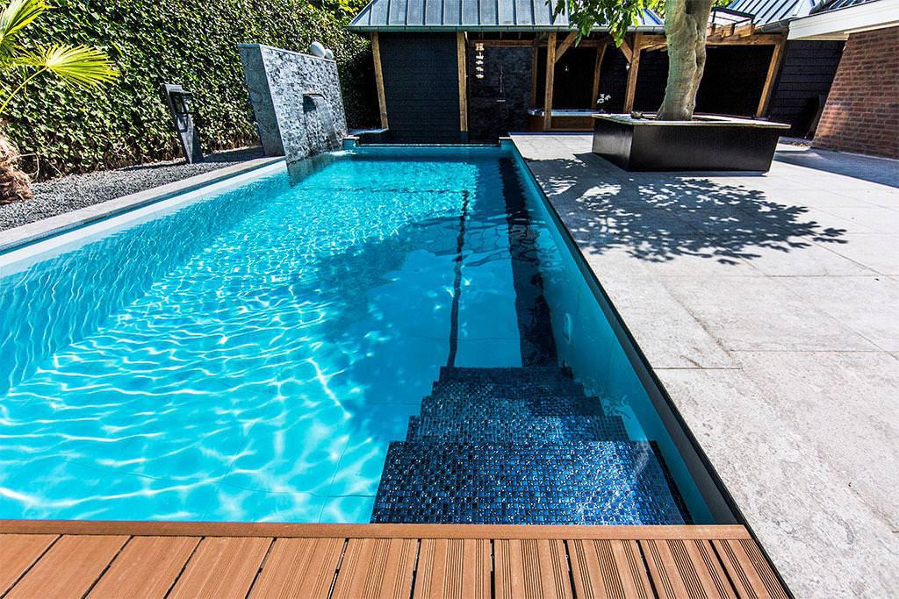
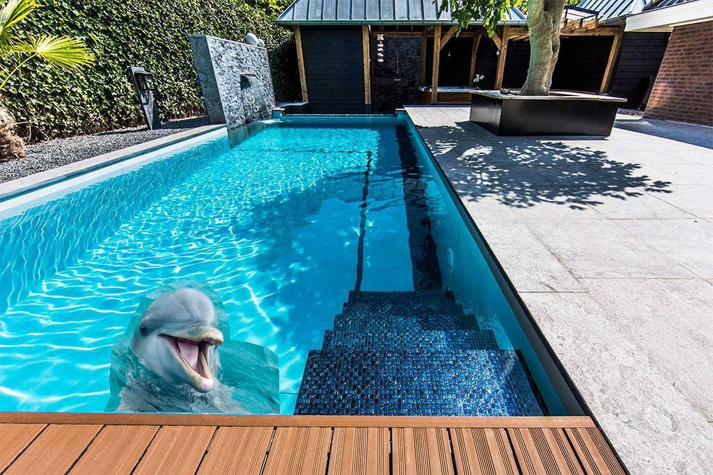

# Poisson Image Blending

This repository implements Poisson image blending in Python using OpenCV and SciPy. It allows seamless blending of a foreground object into a target/background image using a manually defined contour.

## Method

1. **Region Selection:** The user defines a contour around the foreground object to specify the area for blending. This contour is converted into a mask that determines which pixels will be blended and which remain fixed.
2. **Poisson Equation Construction:** Inside the mask, we want the blended image to preserve the gradients of the source image while matching the target image along the boundary. This requirement is formulated as a sparse linear system $Ax = b$, where $x$ represents the unknown pixel values in the masked region.
3. **Solving the System:** The sparse Laplacian matrix $A$ encodes the discrete Laplace operator, and $b$ encodes the source gradients and target boundary conditions. Solving $Ax = b$ yields pixel values that ensure a smooth transition between source and target.
4. **Reconstruction:** The solution values are placed back into the masked region, producing a blended image where the source object appears seamlessly integrated into the target background without visible seams or harsh edges.

## Result

<table>
 <tr>
    <td align="center">Image 1</td>
    <td align="center">Image 2</td>
    <td align="center">Cut and Paste Result</td>
    <td align="center">Poisson Blending Result</td>
  </tr>
  <tr>
    <td></td>
    <td></td>
    <td></td>
    <td></td>
  </tr>
</table>
