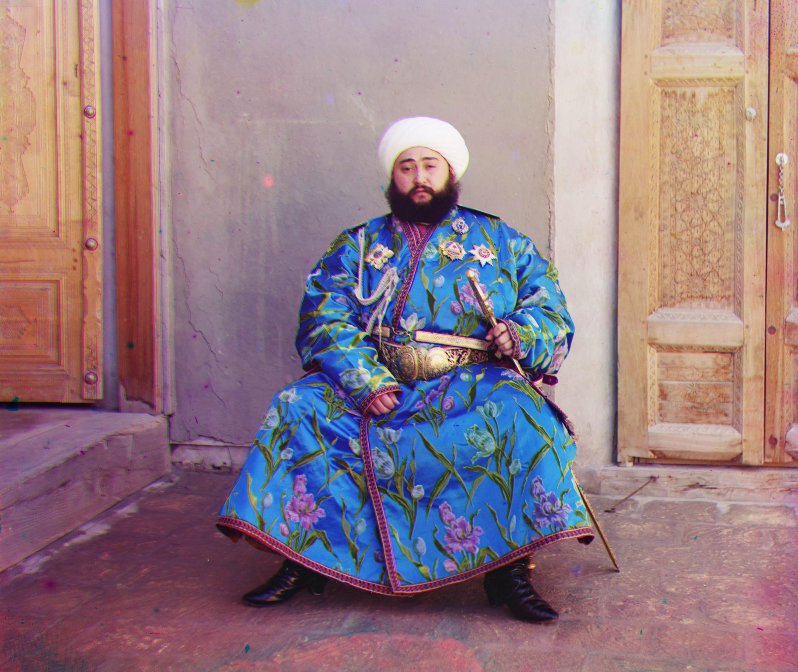
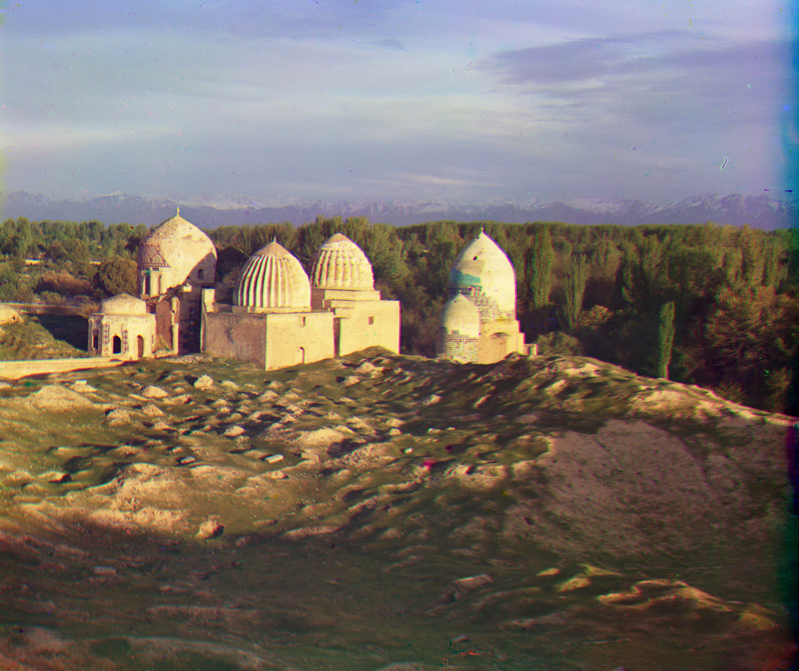
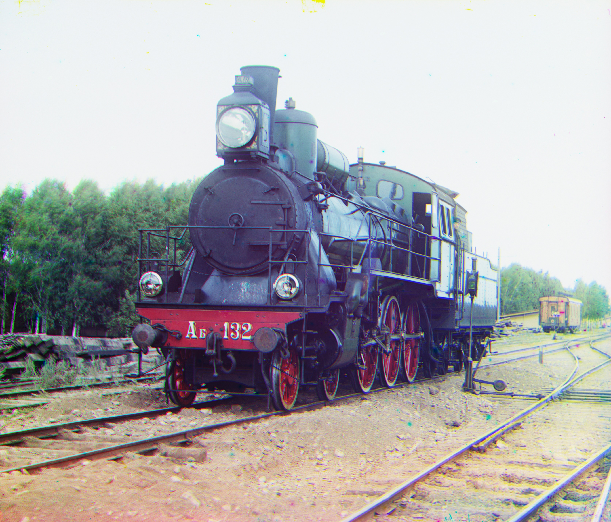

# Prokudin-Gorskii Image Alignment

This project reconstructs color images from historical Prokudin-Gorskii Images, which contain three vertically stacked grayscale exposures of the same scene (Blue, Green, Red). Because the exposures were taken sequentially, the channels are misaligned. The code aligns them automatically and outputs a clean RGB image.

## Method

1. **Split the Image:** The input image is divided into its three grayscale channels: Blue, Green, and Red.
2. **Multi-Scale Alignment (Gaussian Pyramid):** To estimate how much the Blue and Red channels should shift to align with the Green channel, the code constructs a Gaussian pyramid of increasingly downsampled versions of each channel. Coarse levels provide a fast but approximate alignment on small images, and finer levels progressively refine that alignment at higher resolutions.
3. **Shift Estimation (SSD Matching):** At each pyramid level, the method searches for the horizontal/vertical shift that minimizes the Sum of Squared Differences (SSD) between channels.
4. **Border Detection & Cropping:** After alignment, edges are analyzed to detect black borders or damaged areas, and the final image is cropped to valid content.
5. **Reconstruction:** The aligned Blue, Green, and Red channels are merged into the final color image.

## Results

<table>
  <tr>
    <td align="center"><a href="https://tile.loc.gov/storage-services/master/pnp/prok/01800/01886a.tif">Amir</a></td>
    <td align="center"><a href="https://tile.loc.gov/storage-services/master/pnp/prok/01800/01833a.tif">Mosque</td>
    <td align="center"><a href="https://tile.loc.gov/storage-services/master/pnp/prok/00400/00458a.tif">Train</td>
  </tr>
  <tr>
    <td></td>
    <td></td>
    <td></td>
  </tr>
</table>
