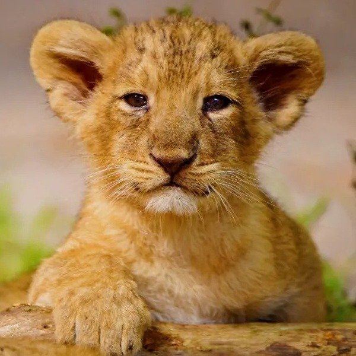
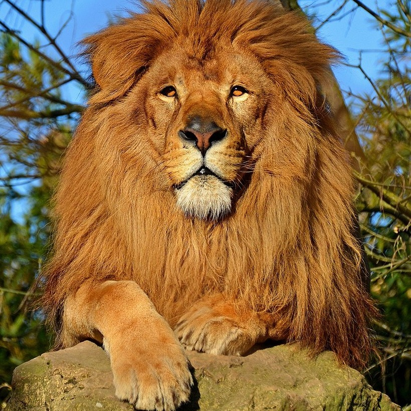

# Image-Processing-Assignments-2021

This repository contains my university image-processing projects (2021–2022).
Library use was restricted, so the code is intentionally naive, unoptimized, and written from scratch for educational purposes.

Each project has its own folder and README with the method and full results. Below are some of my favorites.

## Highlights

### Texture Synthesis (Quadtree Pyramid + Min-Cut)

Generates large textures from a small sample by placing patches that match their overlaps, then blending them along minimum-cut seams.

<table>
  <tr>
    <td align="center">Input Texture</td>
    <td align="center">Synthesized Result</td>
  </tr>
  <tr>
    <td></td>
    <td></td>
  </tr>
  <tr>
    <td></td>
    <td></td>
  </tr>
</table>

[Full project →](<./Texture Synthesis>)

### Image Morphing (Delaunay Triangulation)

Smoothly transitions one image into another by warping matching triangles and cross-dissolving.

<table>
  <tr>
    <td align="center">Source 1</td>
    <td align="center">Source 2</td>
    <td align="center">Morph</td>
  </tr>
  <tr>
    <td></td>
    <td></td>
    <td></td>
  </tr>
</table>

[Full project →](./Morphing)

### Hybrid Images (Frequency-Domain Filtering)

Combines the low frequencies of one image with the high frequencies of another using DFT-based Gaussian filters, so the image changes depending on viewing distance.

<table> <tr> <td align="center">Near Image</td> <td align="center">Far Image</td> <td align="center">Hybrid (Far View)</td> </tr> <tr> <td></td> <td></td> <td></td> </tr> </table> <table> <tr> <td align="center">Hybrid Image (Near View)</td> </tr> <tr> <td></td> </tr> </table>

[Full project →](<./Hybrid Images>)

### Multiresolution Blending and Feathering

Blends two images using Gaussian/Laplacian stacks and pyramids with soft masks for seamless transitions.

<table>
  <tr>
    <td align="center">Image 1</td>
    <td align="center">Image 2</td>
    <td align="center">Pyramid Blend</td>
  </tr>
  <tr>
    <td></td>
    <td></td>
    <td></td>
  </tr>
</table>

[Full project →](<./Multiresolution Blending and Feathering>)

### Patch-Based Inpainting

Fills removed regions by copying texture patches from the surroundings and hiding the joins with min-cut seams.

<table>
  <tr>
    <td align="center">Original</td>
    <td align="center">Inpaint Area</td>
    <td align="center">Result</td>
  </tr>
  <tr>
    <td></td>
    <td></td>
    <td></td>
  </tr>
  <tr>
    <td></td>
    <td></td>
    <td></td>
  </tr>
</table>

[Full project →](<./Image Inpainting>)

### Poisson Image Blending

Seamlessly inserts a foreground object into a new background by solving a sparse linear system in the gradient domain.

<table>
  <tr>
    <td align="center">Cut and Paste</td>
    <td align="center">Poisson Blending</td>
  </tr>
  <tr>
    <td></td>
    <td></td>
  </tr>
</table>

[Full project →](<./Poisson Blending>)

## All Projects

- **Enhancement and filtering:** [Image Enhancement](./Enhancement), [Histogram Matching](<./Histogram Specification>), [Image Smoothing](./Convolution), [Color Processing and Blurring](<./Color Processing and Blurring>), [Image Sharpening](./Sharpening)
- **Frequency domain:** [Hybrid Images](<./Hybrid Images>)
- **Geometry and detection:** [Perspective Warping](<./Homography and Image Warping>), [Chessboard Detection (Hough)](<./Hough Transform>), [Template Matching (NCC)](<./Template Matching>), [Image Morphing](./Morphing)
- **Segmentation and clustering:** [Active Contour](<./Active Contours>), [Mean Shift](<./Mean-Shift Segmentation>), [SLIC Superpixels](./SLIC), [Bird Detection](./Segmentation), [K-Means](./K-means)
- **Blending and synthesis:** [Multiresolution Blending](<./Multiresolution Blending and Feathering>), [Poisson Blending](<./Poisson Blending>), [Patch-Based Inpainting](<./Image Inpainting>), [Texture Synthesis](<./Texture Synthesis>), [Prokudin-Gorskii Alignment](<./Prokudin-Gorskii Images>)
