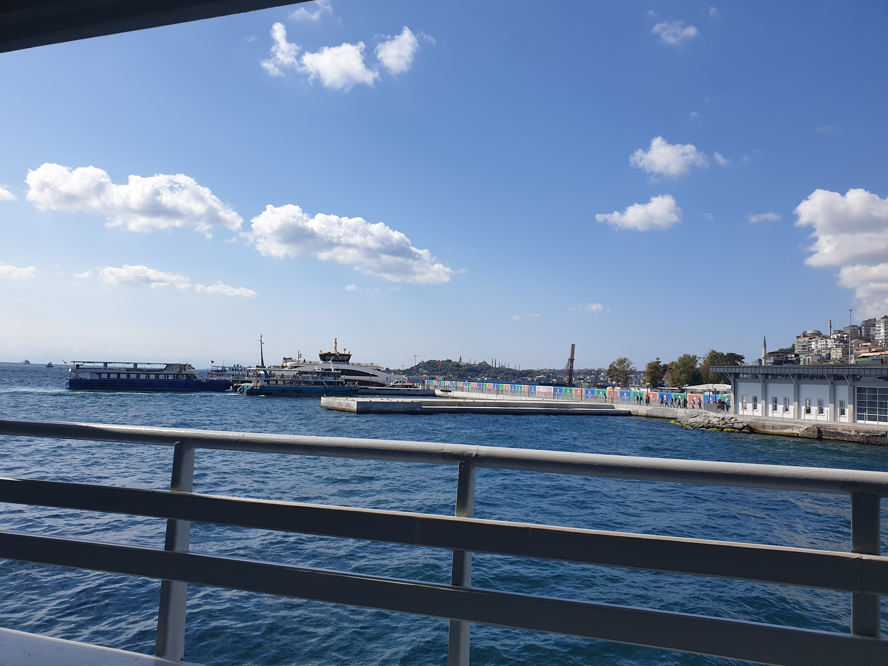
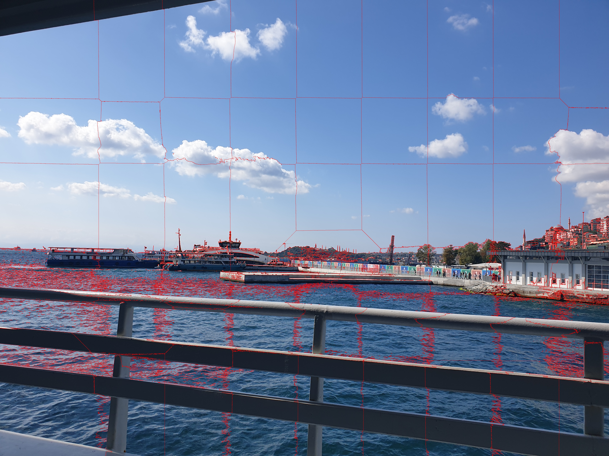
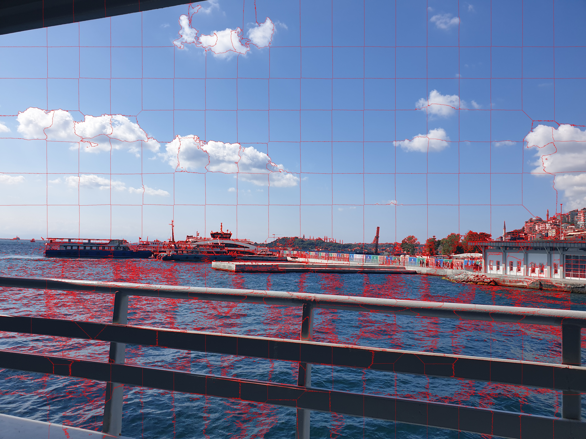
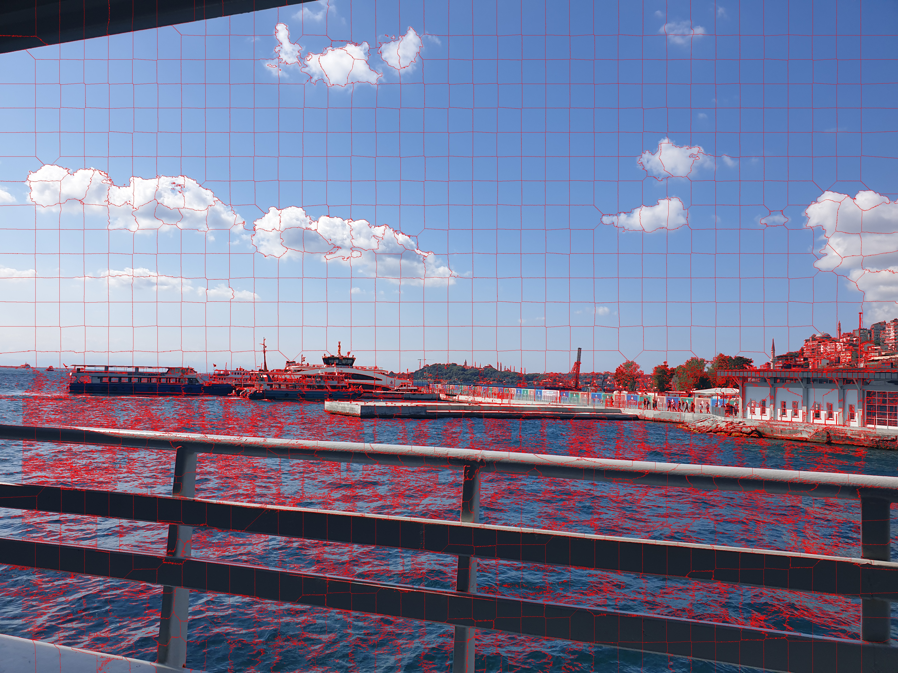
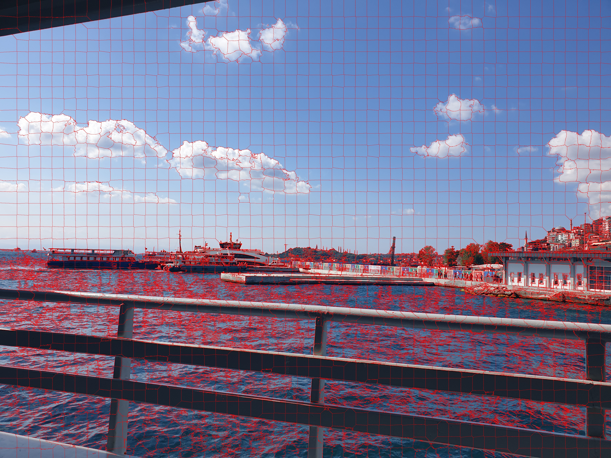

# SLIC Superpixel Segmentation

This project implements a from-scratch version of the SLIC (Simple Linear Iterative Clustering) algorithm using Python, OpenCV, and NumPy to segment an image into approximately equally sized superpixels.

## Method

1. **Gradient Computation:** The input image is converted to grayscale, and horizontal and vertical gradients are computed using Sobel filters. The gradient magnitude is used to identify low-gradient regions, ensuring that initial cluster centers are placed away from edges.
2. **Cluster Center Initialization:** Cluster centers are initialized uniformly on a regular grid according to the desired number of superpixels $K$. Each center is shifted within a small $5 \times 5$ neighborhood to the position with the minimum gradient magnitude, improving alignment with object boundaries.
3. **Feature Vector Construction:** Each pixel is represented by a 5-dimensional feature vector $(L, a, b, x, y)$, where $(L, a, b)$ are the CIELAB color components and $(x, y)$ are the spatial coordinates.
4. **Distance Calculation and Pixel Assignment:** Pixels are assigned to the nearest cluster center within a limited spatial window. The distance metric combines color and spatial distances:

$$
D = D_{lab} + \alpha D_{xy}
$$

    where

$$
D_{lab} = (L_k - L_n)^2 + (a_k - a_n)^2 + (b_k - b_n)^2
$$

$$
D_{xy} = (x_k - x_n)^2 + (y_k - y_n)^2
$$

    and$\alpha$ controls the weight of spatial proximity.

5. **Boundary Detection and Visualization:** After assigning labels, superpixel boundaries are detected by comparing neighboring pixel labels. Boundaries are drawn in red on the original image to visualize the segmentation. This process is repeated for different values of $K$ $(64, 256, 1024, 2048)$, producing separate output images for comparison.

## Result

<table>
 <tr>
    <td align="center">Original Image</td>
  </tr>
  <tr>
    <td></td>
  </tr>
</table>

<table>
 <tr>
    <td align="center">Final Result (K=64)</td>
    <td align="center">Final Result (K=256)</td>
    <td align="center">Final Result (K=1024)</td>
    <td align="center">Final Result (K=2048)</td>
  </tr>
  <tr>
    <td></td>
    <td></td>
    <td></td>
    <td></td>
  </tr>
</table>
