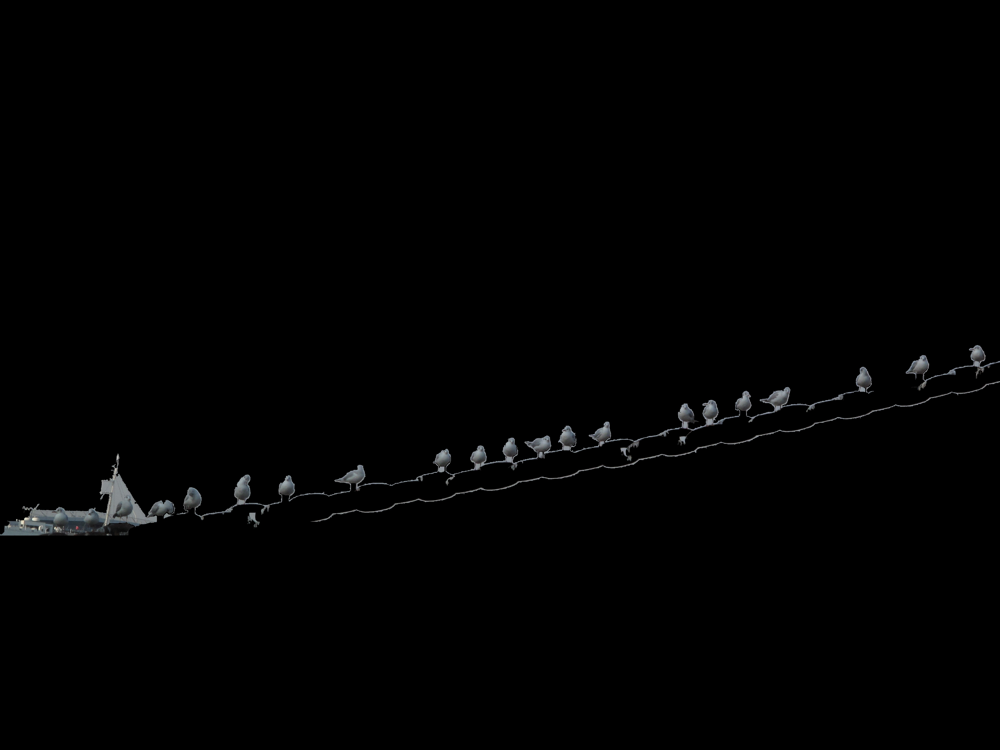

# Bird Detection Using Histogram-Based Segmentation

This Python script detects birds in an image using image segmentation and color histogram matching. It compares segments in a main image with sample bird images to identify and isolate birds.

## Method

1. **Sample Preparation:** Sample bird images are segmented using Felzenszwalb segmentation. Color histograms are computed from the largest segment and stored as reference.
2. **Image Segmentation:** The main image is segmented into regions using Felzenszwalb segmentation. Parameters are tuned to capture bird-sized segments.
3. **Segment Filtering:** Segments that are too small or too large are removed to eliminate noise and background regions.
4. **Histogram Matching:** Color histograms are computed for each remaining segment. Segments are classified as birds if they match any reference histogram within a threshold.

## Result

<table>
 <tr>
    <td align="center">Original Image</td>
    <td align="center">Final Result</td>
  </tr>
  <tr>
    <td></td>
    <td></td>
  </tr>
</table>
