# Image Sharpening

This project demonstrates and compares four image sharpening techniques implemented from scratch in both the spatial domain and the frequency domain. The goal is to enhance edges and fine details in a blurred image while analyzing the behavior of different mathematical approaches.

<table>
 <tr>
    <td align="center">Original Image</td>
  </tr>
  <tr>
    <td>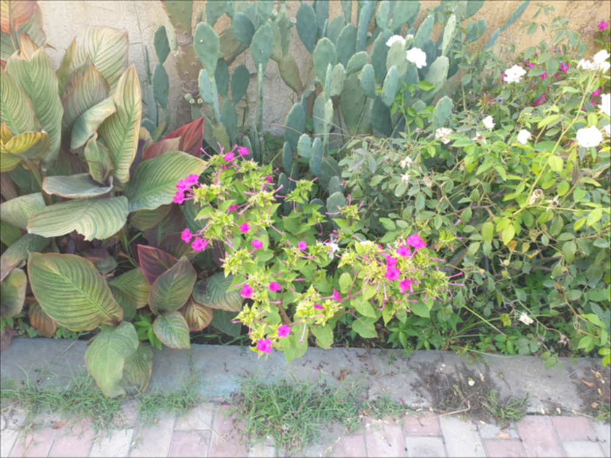</td>
  </tr>
</table>

## Method 1: Spatial-domain unsharp masking using Gaussian smoothing

This method performs classic unsharp masking in the spatial domain:

1. Smooth the image using a Gaussian filter.
2. Compute the unsharp mask by subtracting the smoothed image from the original.
3. Add a scaled version of the mask back to the original image.

**Formula:**

$$
S = f(x,y) + \alpha \big(f(x,y) - G_{\sigma}*f(x,y)\big)
$$

**where:**

* $ \alpha$ controls the sharpening strength.

## Result 1

<table>
 <tr>
    <td align="center">Gaussian Filter</td>
    <td align="center">Smoothed Image</td>
    <td align="center">Unsharp Mask</td>
    <td align="center">Final Result</td>
  </tr>
  <tr>
    <td>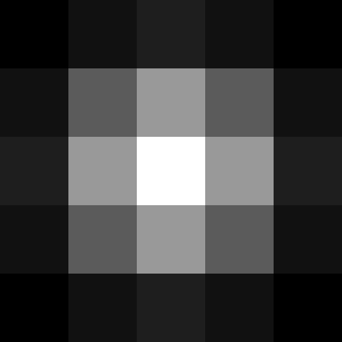</td>
    <td></td>
    <td>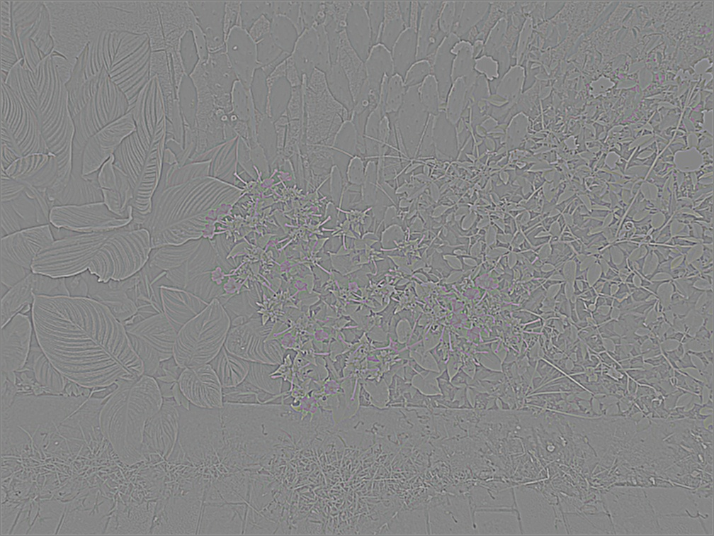</td>
    <td>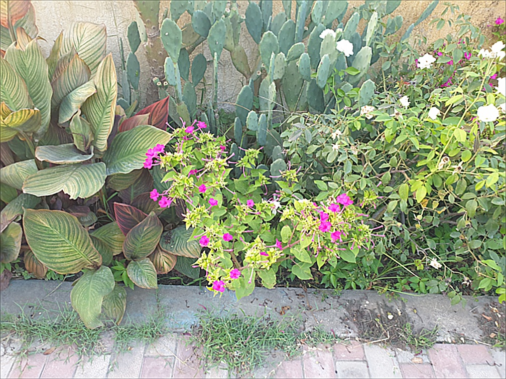</td>
  </tr>
</table>

## Method 2: Spatial-domain Laplacian of Gaussian (LoG)

This approach sharpens the image by enhancing regions of rapid intensity change using the Laplacian of Gaussian (LoG):

1. Smooth the image with a Gaussian kernel.
2. Apply the Laplacian operator to detect edges.
3. Subtract the scaled Laplacian response from the original image.

**Formula:**

$$
S = f(x,y) - k \nabla^2 \big(G_\sigma * f(x,y)\big)
$$

**where:**

- $\nabla^2$ is the Laplacian operator,
- $G_\sigma$ is the Gaussian kernel,
- $k$ controls sharpening intensity

## Result 2

<table>
 <tr>
    <td align="center">Laplacian of Gaussian Filter</td>
    <td align="center">Unsharp Mask</td>
    <td align="center">Final Result</td>
  </tr>
  <tr>
    <td></td>
    <td>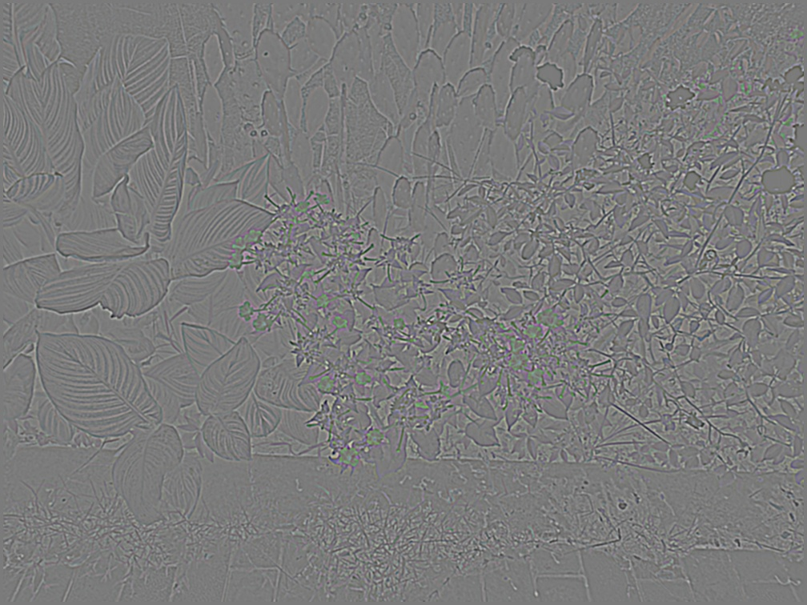</td>
    <td></td>
  </tr>
</table>

## Method 3: Frequency-domain sharpening using a Gaussian high-pass filter

In this method, sharpening is performed in the frequency domain:

1. Compute the 2D Discrete Fourier Transform (DFT) of the image.
2. Shift the zero-frequency component to the center.
3. Apply a Gaussian high-pass filter.
4. Inverse transform back to the spatial domain.

**2D DFT Definition:**

$$
F(u,v) = \sum_{x=0}^{M-1} \sum_{y=0}^{N-1}
f(x,y)\, e^{-j2\pi\left(\frac{ux}{M} + \frac{vy}{N}\right)}
$$

**Formula:**

$$
S = F^{-1}\{(1 + k H_{HP}(u,v)) \cdot F\}
$$

## Result 3

<table>
 <tr>
    <td align="center">DFT Magnitude</td>
    <td align="center">High-pass Filter</td>
    <td align="center">High-pass Filtered DFT</td>
    <td align="center">Final Result</td>
  </tr>
  <tr>
    <td>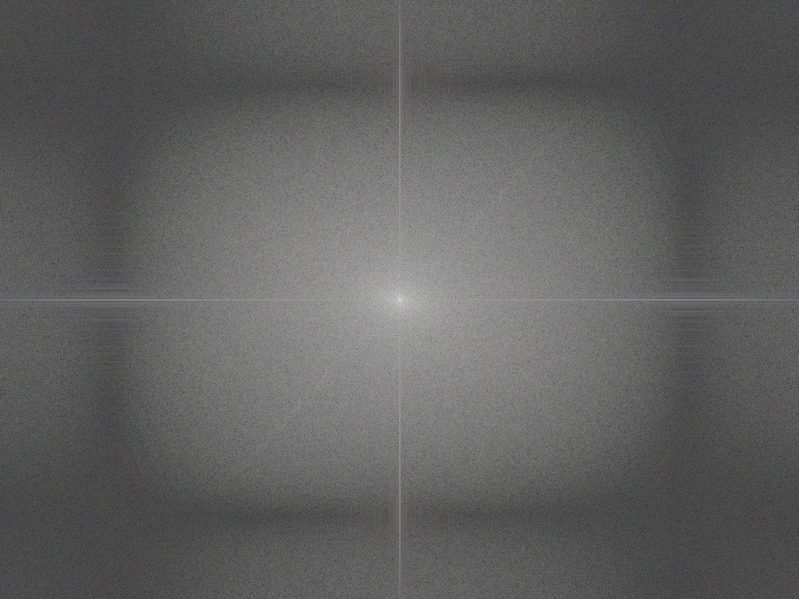</td>
    <td>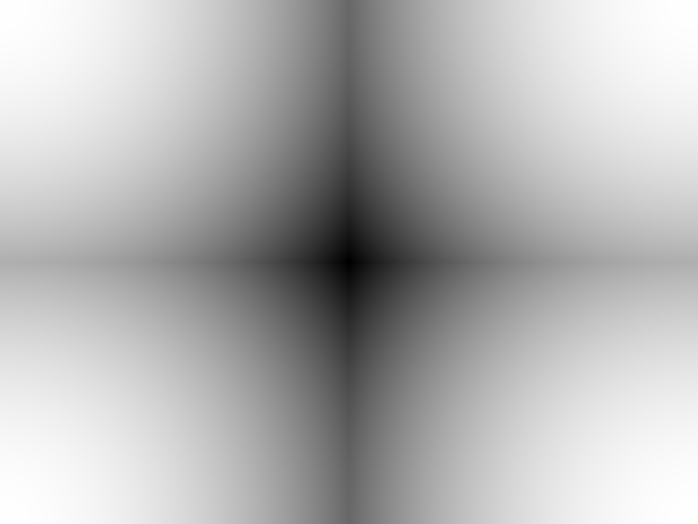</td>
    <td>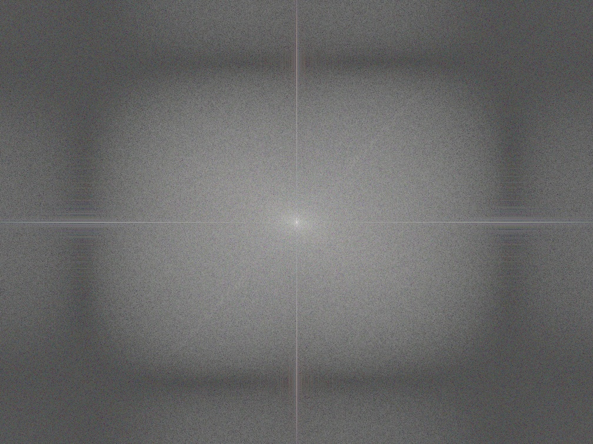</td>
    <td>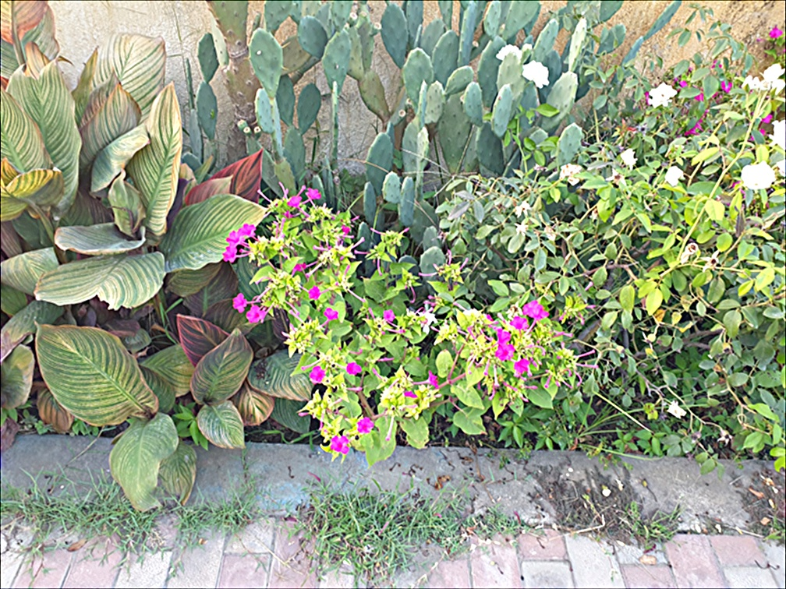</td>
  </tr>
</table>

## Method 4: Frequency-domain sharpening using the Laplacian operator

This method applies the Laplacian operator directly in the frequency domain, leveraging the property:

$$
\nabla^2 f(x,y) \;\longleftrightarrow\; -4\pi^2 (u^2 + v^2) F(u,v)
$$

1. Compute the DFT of the image.
2. Multiply by the frequency-domain Laplacian operator.
3. Apply the inverse DFT to obtain the spatial Laplacian.
4. Add a scaled version to the original image for sharpening.

**Formula:**

$$
S = f(x,y) + k \cdot \nabla^2 f(x,y)
$$

## Result 4

<table>
 <tr>
    <td align="center">Laplacian in Frequency Domain</td>
    <td align="center">Laplacian in Spatial Somain</td>
    <td align="center">Final Result</td>
  </tr>
  <tr>
    <td>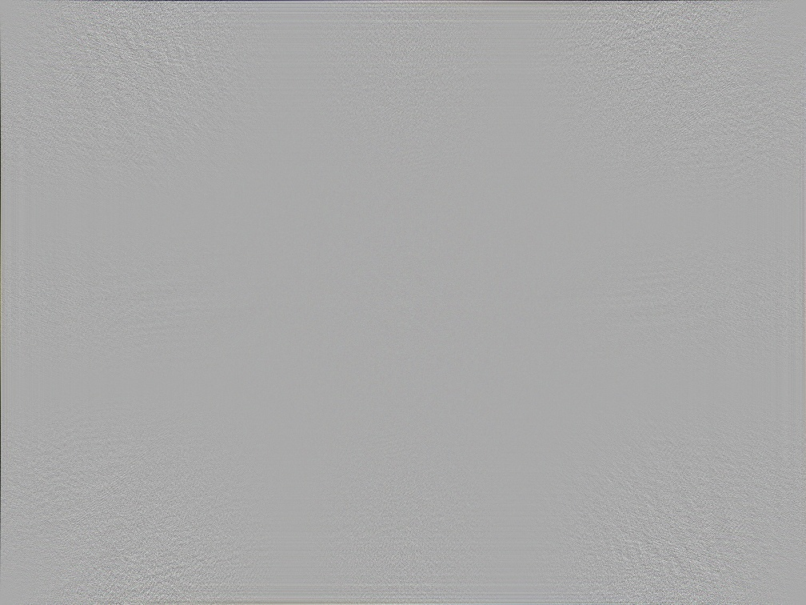</td>
    <td>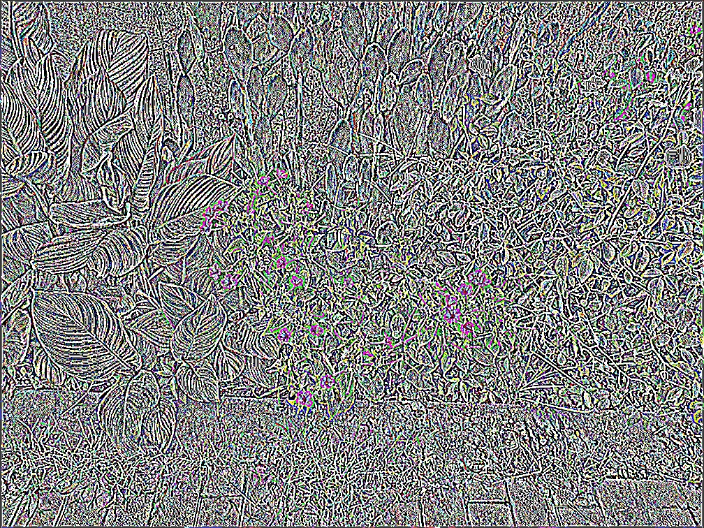</td>
    <td></td>
  </tr>
</table>
