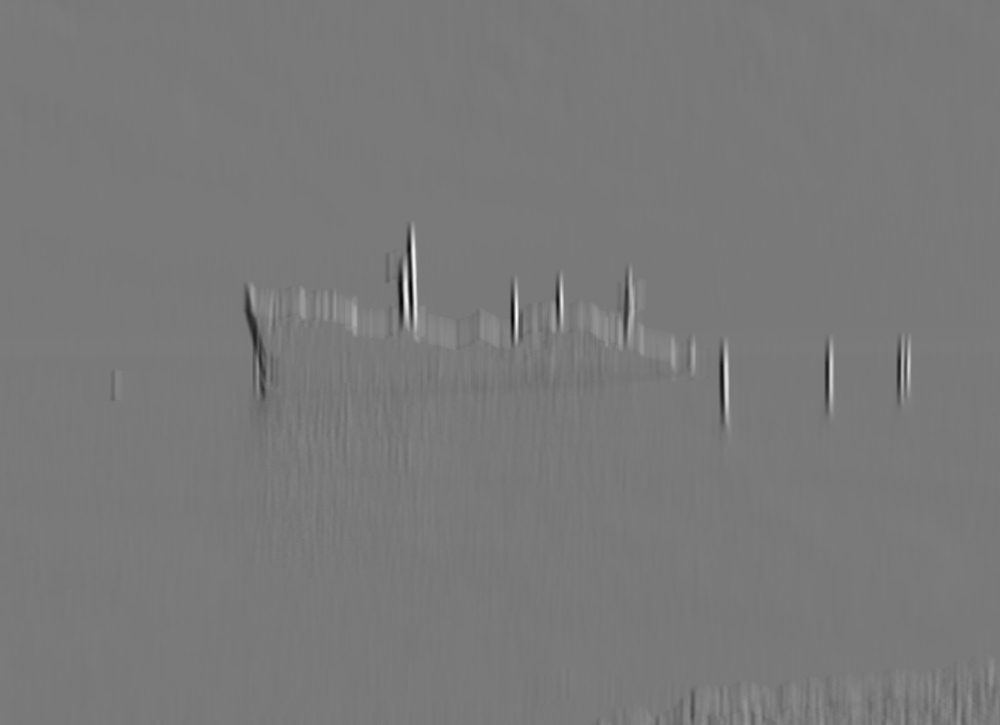
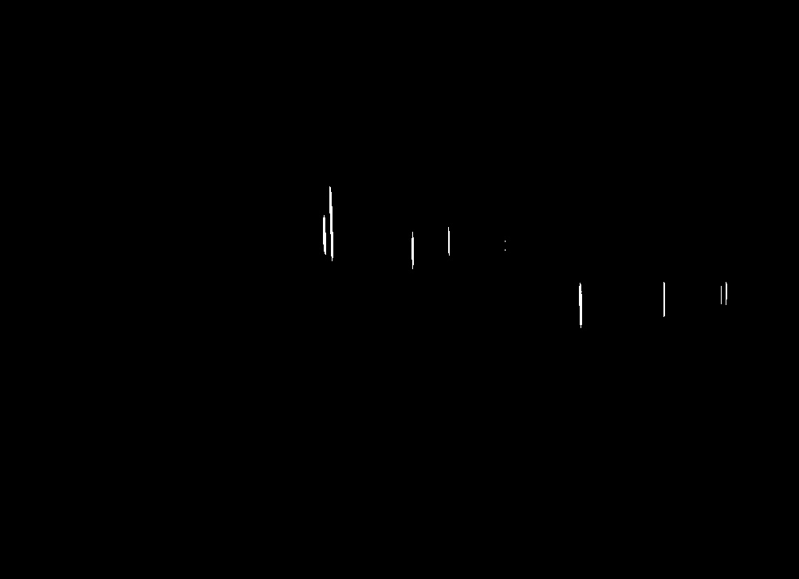
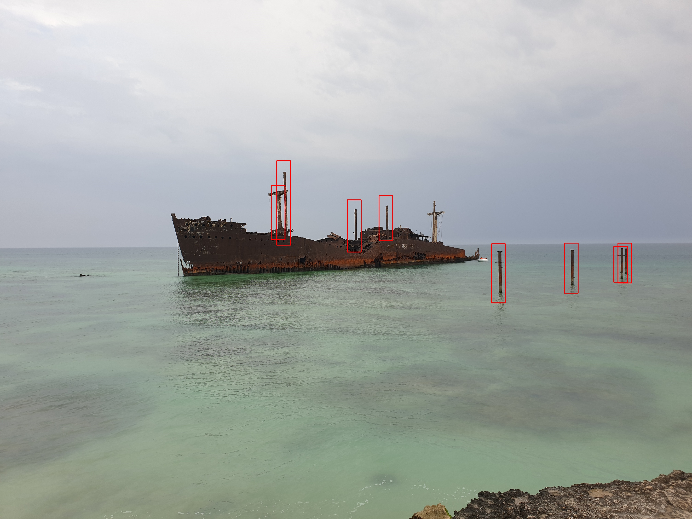

# Template Matching Using Normalized Cross-Correlation (NCC)

This project demonstrates template matching in images using normalized cross-correlation (NCC). The goal is to detect and highlight regions in a larger image that closely match a given template.

## Method

1. **Template Extraction:** Crop a smaller patch from the template image for matching.
2. **NCC Computation:** Slide the template over the image and compute normalized cross-correlation at each position.
3. **Detection & Visualization:** Threshold the correlation map, identify regions, and draw bounding boxes on matches.

$$
NCC(x, y) = \frac{\sum_{i,j} \big(I(x+i, y+j) - \bar{I}_{x,y}\big) \cdot \big(T(i,j) - \bar{T}\big)}{\sqrt{\sum_{i,j} \big(I(x+i, y+j) - \bar{I}_{x,y}\big)^2 \cdot \sum_{i,j} \big(T(i,j) - \bar{T}\big)^2}}
$$

## Result

<table>
 <tr>
    <td align="center">Original Image</td>
    <td align="center">Template</td>
    <td align="center">NCC</td>
    <td align="center">NCC Mask</td>
    <td align="center">Final Result</td>
  </tr>
  <tr>
    <td></td>
    <td></td>
    <td></td>
    <td></td>
    <td></td>
  </tr>
</table>
