# Texture Synthesis using Quadtree Texture Pyramid and Min-Cut

This project implements a patch-based texture synthesis algorithm that uses a Quadtree Texture Pyramid (QTP) for multi-scale patch comparison, minimum-cut seams to blend overlapping patches smoothly, and random patch selection guided by boundary similarity metrics. The algorithm can generate large textures from a small sample while preserving visual consistency and minimizing seams between patches.

## Method

1. **Patch Selection:** Select candidate patches that match the overlapping boundaries with previously placed patches. Distance is computed as:

   $$
   d = \sqrt{\frac{\sum (\text{boundary}_{\text{existing}} - \text{boundary}_{\text{candidate}})^2}{A}}
   $$

   Accept patches below the threshold:

   $$
   d_{\max} = \epsilon \sqrt{\frac{\sum \text{boundary}^2}{A}}
   $$

   where $A$ is the number of overlapping pixels and $\epsilon$ controls tolerance.
2. **Multi-Resolution Quadtree Pyramid:** Construct a quadtree pyramid of each patch for coarse-to-fine matching.Each node is downsampled by 2 with optional offset $(x_s, y_s)$**:**

   $$
   I_{\text{half}}[i,j] = I[2i + x_s, 2j + y_s]
   $$
3. **Min-Cut Seam:** Once a candidate patch is selected, overlapping regions are blended using a min-cut algorithm. An error surface is computed for overlapping pixels, and a minimal-cost path is found (vertical or horizontal). Pixels on one side of the path come from the new patch, the other from existing texture, minimizing visible seams.
4. **Patch Placement:** Synthesize texture patch by patch; the first patch is random. Subsequent patches are selected based on neighboring overlaps (top/left).
5. **Parallelization (Optional):** Patch placement along a diagonal can be computed in parallel using multiple CPU cores. Each patch depends only on already placed neighbors, making multi-core execution safe.

## Result

<table>
 <tr>
    <td align="center">Input Texture</td>
    <td align="center">Synthesized Result</td>
  </tr>
  <tr>
    <td>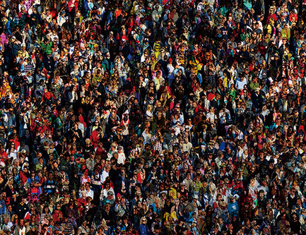</td>
    <td>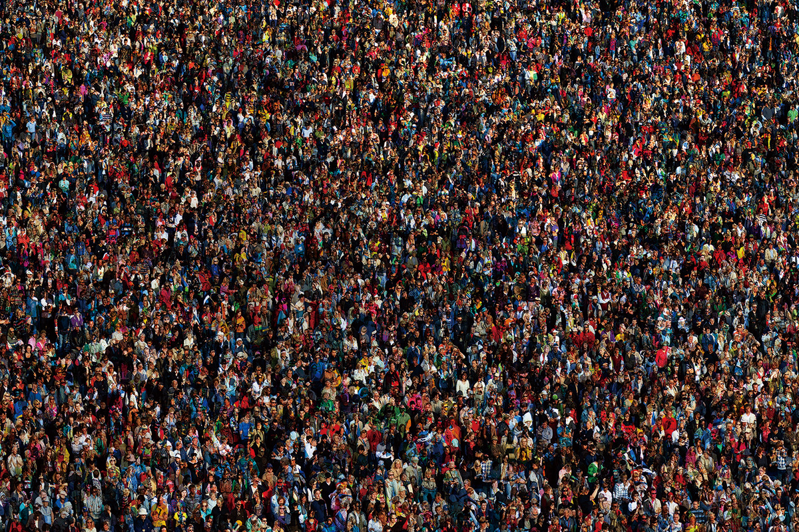</td>
  </tr>
  <tr>
    <td>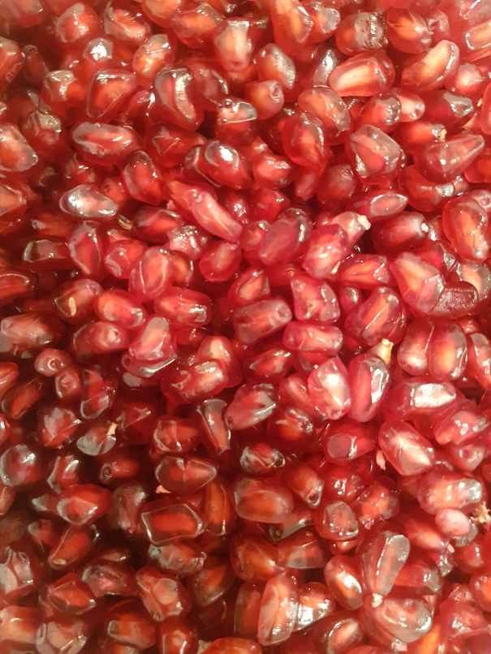</td>
    <td>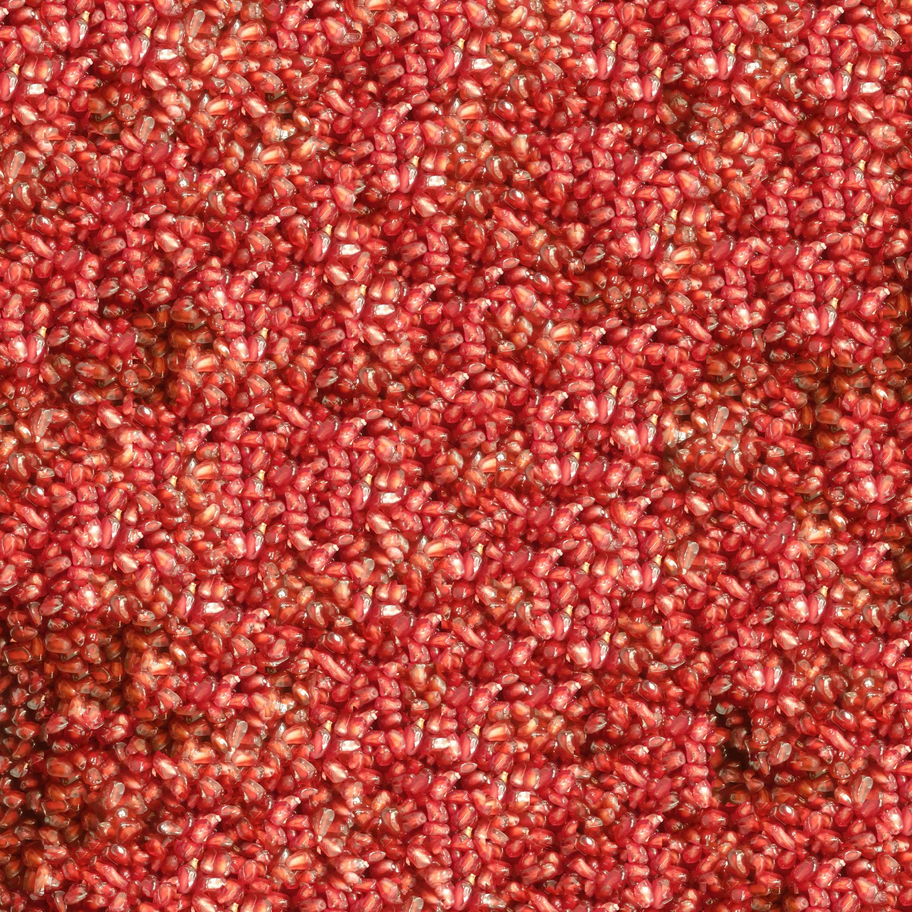</td>
  </tr>
  <tr>
    <td>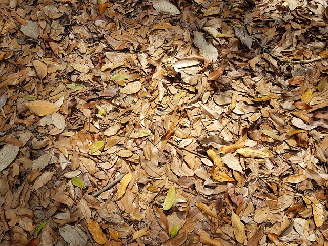</td>
    <td>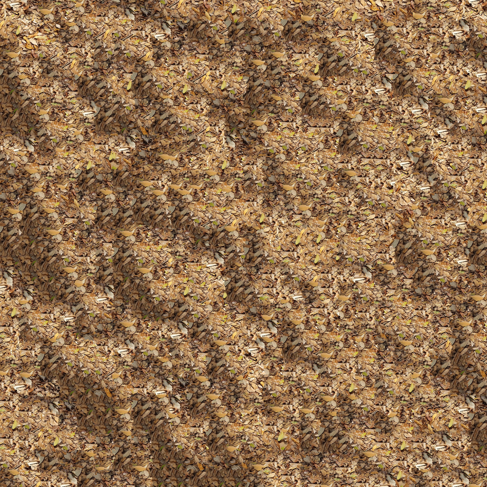</td>
  </tr>
  <tr>
    <td>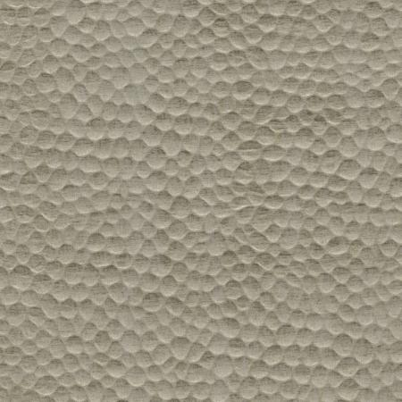</td>
    <td>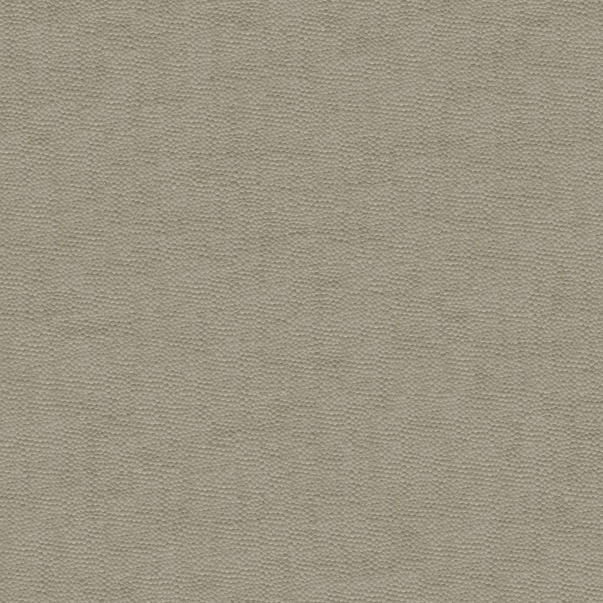</td>
  </tr>
  <tr>
    <td>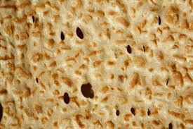</td>
    <td>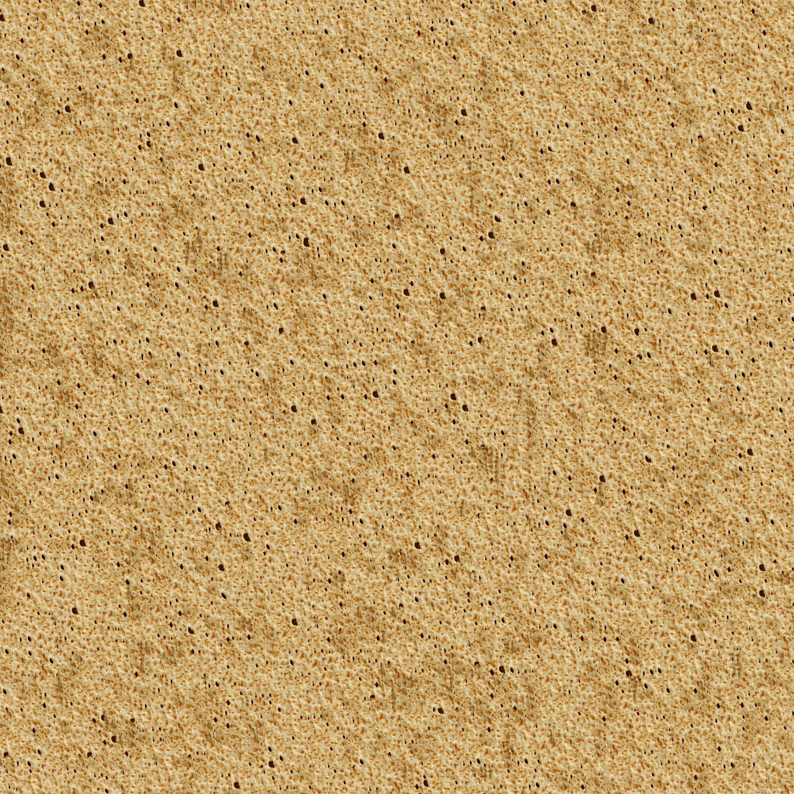</td>
  </tr>
  <tr>
    <td>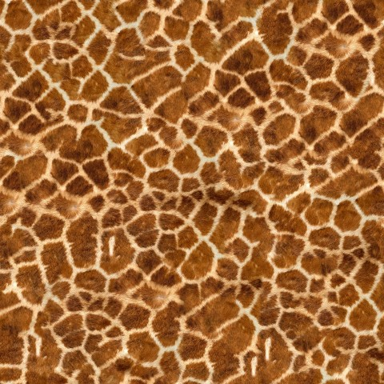</td>
    <td>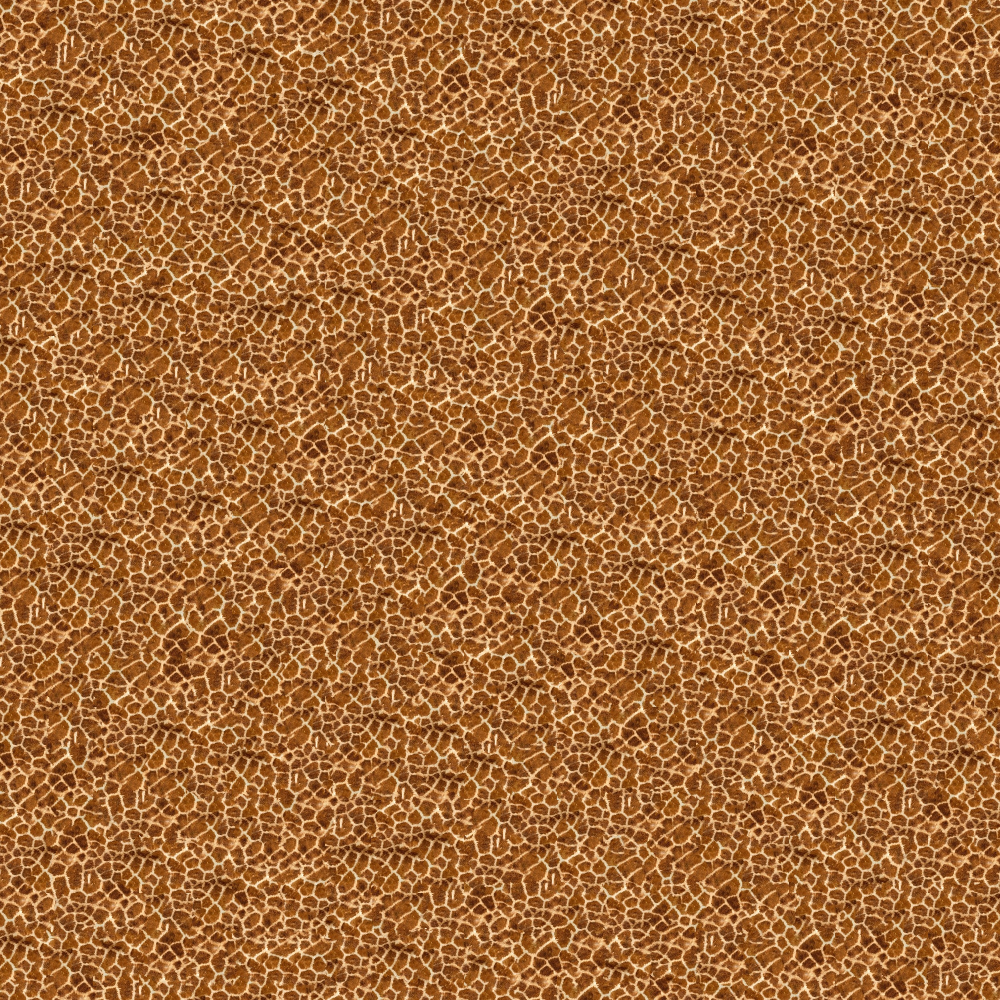</td>
  </tr>
</table>
